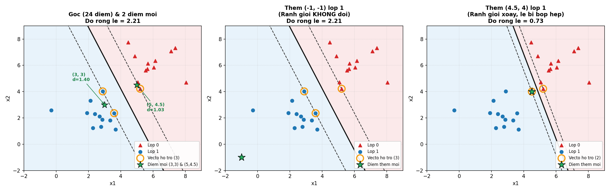
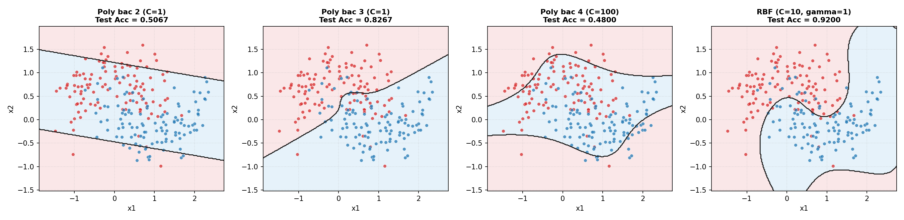
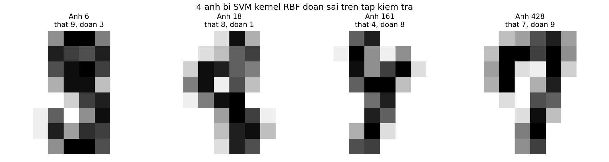
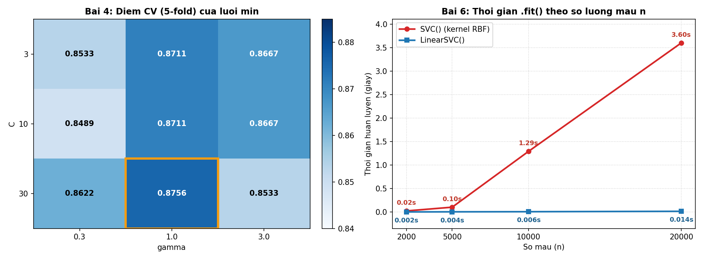

# Báo Cáo & Lời Giải Bài Tập Thực Hành 6: Máy Vectơ Hỗ Trợ (SVM)

Tài liệu: `Lab06_SVM.pdf`  
Môn học: **Học máy ứng dụng** - Khoa Công nghệ Thông tin, Trường Đại học Văn Lang  
Giảng viên: **ThS. Nguyễn Thái Anh**  
Năm học: 2026 – 2027

---

## 📁 Cấu trúc thư mục

```text
06. SVM/
├── data/
│   ├── sinh_vien.csv                               # Dữ liệu sinh viên (2 cột: giờ ôn, điểm giữa kỳ)
│   ├── sinh_vien_mo_rong.csv                       # Dữ liệu sinh viên mở rộng (thêm cột chi tiêu)
│   └── hai_vang_trang.csv                          # Dữ liệu phân loại 2 lớp có biên cong phi tuyến
├── baitap06/                                       # 6 bài tập tự luyện được yêu cầu nộp
│   ├── bai1.py                                     # Tính tay f(x) và khoảng cách tới ranh giới
│   ├── bai2.py                                     # Thêm điểm (-1, -1) và (4.5, 4) — vai trò vectơ hỗ trợ
│   ├── bai3.py                                     # Kernel đa thức bậc 2, 3, 4 (GridSearchCV + Pipeline)
│   ├── bai4.py                                     # Dò lưới mịn quanh (C=10, gamma=1)
│   ├── bai5.py                                     # Bảng nhầm lẫn 10x10 & phân tích 4 ảnh chữ số đoán sai
│   ├── bai6.py                                     # So sánh thời gian .fit() giữa SVC() và LinearSVC()
│   ├── screenshot_bai1.png -> screenshot_bai6.png  # Ảnh chụp màn hình kết quả chạy terminal
│   ├── bai5_anh_sai_1_idx6_that9_doan3.png         # Ảnh đoán sai #1 (thật 9, đoán 3)
│   ├── bai5_anh_sai_2_idx18_that8_doan1.png        # Ảnh đoán sai #2 (thật 8, đoán 1)
│   ├── bai5_anh_sai_3_idx161_that4_doan8.png       # Ảnh đoán sai #3 (thật 4, đoán 8)
│   ├── bai5_anh_sai_4_idx428_that7_doan9.png       # Ảnh đoán sai #4 (thật 7, đoán 9)
│   ├── bai5_tong_hop_anh_sai.png                   # Hình tổng hợp cả 4 ảnh bị đoán sai
│   ├── hinh_anh_le_va_sv.png                       # Biểu đồ minh họa lề, vectơ hỗ trợ (Bài 1 & Bài 2)
│   ├── hinh_anh_kernel_hai_vang_trang.png          # Biên quyết định Poly bậc 2, 3, 4 vs RBF (Bài 3)
│   ├── hinh_anh_luoi_min_va_thoi_gian.png          # Heatmap lưới mịn (Bài 4) & Thời gian học (Bài 6)
│   └── README.md                                   # Báo cáo tổng hợp chi tiết
├── tao_anh_chup.py                                 # Script tự động chụp màn hình terminal PowerShell
└── ve_bieu_do.py                                   # Script vẽ các biểu đồ trực quan phân tích
```

### Cách thực thi các bài tập

Từ thư mục `06. SVM`:
```bash
# Chạy từng bài tập trong thư mục baitap06 theo đúng yêu cầu đề bài
python baitap06/bai1.py
python baitap06/bai2.py
python baitap06/bai3.py
python baitap06/bai4.py
python baitap06/bai5.py
python baitap06/bai6.py
```
*(Các script sử dụng đường dẫn `data/...` đúng như yêu cầu đề bài, đồng thời có cơ chế dự phòng tự tìm tệp dữ liệu nếu chạy từ thư mục khác).*

---

## 📌 Tổng quan các con số kết quả chính

Bảng đối chiếu kết quả thực nghiệm với Phụ lục A (Bảng 3) của tài liệu thực hành:

| Đại lượng | Giá trị thực nghiệm | Ý nghĩa / Ghi chú |
|---|---|---|
| 24 điểm tách được: $w_1, w_2, b$ | `-0.831, -0.355, 4.820` | Độ dài $\|w\| = 0.9039$, độ rộng lề = **2.2126** |
| Số vectơ hỗ trợ (24 điểm) | **3** (điểm 18, 10, 13) | Khoảng cách mỗi SV tới ranh giới = **1.1063** (= lề / 2) |
| Thêm `(-1, -1)` lớp 1 | $w, b$, lề **không đổi** | $f_{\text{cũ}} = +6.007 > 1$ (nằm ngoài lề, không phải SV) |
| Thêm `(4.5, 4)` lớp 1 | Lề giảm **2.2126 → 0.7339** | $f_{\text{cũ}} = -0.340 < 1$ (vi phạm lề, trở thành SV mới) |
| Kernel đa thức (d = 2, 3, 4) trên hai vầng trăng | Tốt nhất **d = 3** (`C = 1`) | CV = **0.8178**, Test = **0.8267** (thua RBF 0.9200) |
| Dò lưới thưa mục 5 (RBF) | `C = 10, gamma = 1` | CV = **0.8711**, Test = **0.9200** |
| Dò lưới mịn Bài 4 (RBF) | `C = 30, gamma = 1` | CV = **0.8756** ($\uparrow +0.0044$), Test = **0.9200** (không đổi) |
| Chữ số viết tay (`load_digits`) | Accuracy = **0.9911** | Chỉ sai **4 / 450** ảnh kiểm tra |
| Thời gian học tăng khi $n$ gấp đôi | `SVC`: **~5.9 lần** / `LinearSVC`: **~2.1 lần** | Ở $n = 20{,}000$, `LinearSVC` nhanh hơn `SVC` **~222 lần** |

---

## 📝 Lời giải & Phân tích chi tiết từng bài tập

---

### Bài tập 1: Tính tay khoảng cách tới ranh giới

#### 1. Yêu cầu đề bài
- Dùng $w_1, w_2, b$ in ra ở mục 2, tự tính $f(x)$ cho hai điểm $(3, 3)$ và $(5, 4.5)$ bằng phép nhân và cộng, **không dùng** `decision_function`.
- Tính khoảng cách từ một điểm tới đường ranh giới bằng công thức $\frac{|f(x)|}{\sqrt{w_1^2 + w_2^2}}$ cho hai điểm trên và cho ba vectơ hỗ trợ.
- Giải thích vì sao khoảng cách của ba vectơ hỗ trợ bằng đúng một nửa độ rộng lề.

#### 2. Kết quả tính tay
Từ mô hình SVM tuyến tính ($C = 1000$) trên 24 điểm mục 2:
- $w_1 = -0.831357$, $w_2 = -0.354868$, $b = 4.820361$
- $\|w\| = \sqrt{w_1^2 + w_2^2} = 0.9039$
- Độ rộng lề $= \frac{2}{\|w\|} = \mathbf{2.2126} \implies$ Nửa độ rộng lề $= \frac{1}{\|w\|} = \mathbf{1.1063}$

| Điểm $x = (x_1, x_2)$ | Vai trò | Giá trị $f(x) = w_1 x_1 + w_2 x_2 + b$ | Khoảng cách $d(x) = \frac{\|f(x)\|}{\|w\|}$ | Vị trí so với lề ($1.1063$) |
|---|---|---|---|---|
| **$(3.0, 3.0)$** | Điểm mới 1 | $+1.262$ | **`1.3958`** | Ngoài lề (phía lớp 1) |
| **$(5.0, 4.5)$** | Điểm mới 2 | $-0.933$ | **`1.0325`** | Bên trong lề (phía lớp 0, kém chắc chắn) |
| Điểm 18 `(5.20, 4.22)` | Vectơ hỗ trợ (lớp 0) | $-1.0001$ | **`1.1064`** | Đúng trên mép lề $f(x) = -1$ |
| Điểm 10 `(2.88, 4.02)` | Vectơ hỗ trợ (lớp 1) | $+0.9999$ | **`1.1062`** | Đúng trên mép lề $f(x) = +1$ |
| Điểm 13 `(3.59, 2.36)` | Vectơ hỗ trợ (lớp 1) | $+1.0002$ | **`1.1065`** | Đúng trên mép lề $f(x) = +1$ |

*(Sai lệch nhỏ ở chữ số thập phân thứ 4 là sai số hội tụ số học bên trong thư viện LIBSVM).*

#### 3. Giải thích vì sao khoảng cách của ba vectơ hỗ trợ bằng đúng một nửa độ rộng lề
1. Đường ranh giới quyết định là tập hợp các điểm thỏa mãn $f(x) = w_1 x_1 + w_2 x_2 + b = 0$.
2. Hai mép lề là hai đường thẳng song song nằm đối xứng hai bên đường ranh giới: $f(x) = +1$ (phía lớp 1) và $f(x) = -1$ (phía lớp 0).
3. Trong bài toán phân tách lề cứng (hai lớp tách hoàn toàn, $C$ rất lớn), mọi vectơ hỗ trợ đều nằm **đúng trên một trong hai mép lề**, tức là thỏa mãn $|f(x)| = 1$.
4. Thay $|f(x)| = 1$ vào công thức khoảng cách hình học tới đường thẳng $f(x) = 0$:
   $$d(x_{\text{SV}}) = \frac{|f(x_{\text{SV}})|}{\sqrt{w_1^2 + w_2^2}} = \frac{1}{\sqrt{w_1^2 + w_2^2}}$$
5. Trong khi đó, độ rộng lề là khoảng cách giữa hai mép lề $f(x) = +1$ và $f(x) = -1$:
   $$\text{lề} = \frac{|1 - (-1)|}{\sqrt{w_1^2 + w_2^2}} = \frac{2}{\sqrt{w_1^2 + w_2^2}}$$
6. Vì đường ranh giới $f(x) = 0$ nằm **chính giữa** hai mép lề song song $f(x) = \pm 1$, nên khoảng cách từ cả ba vectơ hỗ trợ tới đường ranh giới luôn bằng đúng một nửa độ rộng lề:
   $$d(x_{\text{SV}}) = \frac{1}{\|w\|} = \frac{1}{2} \cdot \frac{2}{\|w\|} = \frac{\text{lề}}{2} \approx 1.1063$$

---

### Bài tập 2: Thêm một điểm

#### 1. Yêu cầu đề bài
- Thêm vào 24 điểm của mục 2 một điểm lớp 1 tại $(-1, -1)$, học lại và in $w_1, w_2, b$.
- Sau đó bỏ điểm đó, thay bằng một điểm lớp 1 tại $(4.5, 4)$, học lại và in lần nữa.
- Cho biết lần nào đường ranh giới thay đổi và giải thích bằng khái niệm vectơ hỗ trợ.

#### 2. Bảng so sánh kết quả thực nghiệm

| Trường hợp | $w_1$ | $w_2$ | $b$ | Độ rộng lề | Số SV | Chỉ số các vectơ hỗ trợ | Giá trị $f_{\text{cũ}}$ của điểm mới |
|---|---|---|---|---|---|---|---|
| **0. Gốc (24 điểm)** | `-0.831` | `-0.355` | `4.820` | `2.2126` | `3` | `[18, 10, 13]` | — |
| **1. Thêm `(-1, -1)`, lớp 1** | **`-0.831`** | **`-0.355`** | **`4.820`** | **`2.2126`** | **`3`** | **`[18, 10, 13]`** | **`+6.007`** |
| **2. Thêm `(4.5, 4)`, lớp 1** | **`-2.603`** | **`-0.807`** | **`15.941`** | **`0.7339`** | **`2`** | **`[18, 24]`** | **`-0.340`** |

#### 3. Trả lời & Giải thích bằng khái niệm vectơ hỗ trợ
- **Lần nào đường ranh giới thay đổi?**
  - **Lần 1 — Thêm `(-1, -1)` lớp 1**: Đường ranh giới **KHÔNG THAY ĐỔI** ($w_1, w_2, b$ và độ rộng lề giữ nguyên hoàn toàn).
  - **Lần 2 — Thêm `(4.5, 4)` lớp 1**: Đường ranh giới **THAY ĐỔI RÕ RỆT** ($w_1$ đổi từ `-0.831` sang `-2.603`, $w_2$ từ `-0.355` sang `-0.807`, $b$ từ `4.820` sang `15.941`, độ rộng lề bị bóp hẹp mạnh từ `2.2126` xuống còn `0.7339`).
- **Giải thích bằng khái niệm vectơ hỗ trợ**:
  1. Trong SVM, đường ranh giới và hai mép lề **chỉ do các vectơ hỗ trợ quyết định** (những điểm nằm sát ranh giới nhất). Các điểm nằm đúng phía và ở ngoài lề không đóng góp bất kỳ lực đẩy nào lên siêu phẳng tối ưu.
  2. Điểm **`(-1, -1)`** (lớp 1) có $f_{\text{cũ}}(-1, -1) = +6.007 \gg +1$, nằm rất sâu trong vùng lớp 1 và hoàn toàn **ngoài lề**. Vì vậy nó không trở thành vectơ hỗ trợ, tập 3 vectơ hỗ trợ cũ `[18, 10, 13]` giữ nguyên $\implies$ đường ranh giới không hề dịch chuyển.
  3. Điểm **`(4.5, 4)`** (lớp 1) có $f_{\text{cũ}}(4.5, 4) = -0.340 < +1$ (thậm chí mang dấu âm, nằm lấn sang phía lớp 0 của ranh giới cũ). Điểm này **vi phạm nghiêm trọng ràng buộc lề** $f(x) \ge 1$. Với $C = 1000$ phạt rất nặng, SVM buộc phải dịch chuyển và xoay đường ranh giới về phía cụm lớp 0, thu hẹp độ rộng lề để phân tách đúng điểm này. Khi đó `(4.5, 4)` (chỉ số 24) trở thành **vectơ hỗ trợ mới** thay thế cho hai điểm 10 và 13, cùng điểm 18 (lớp 0) định hình hai mép lề mới.



---

### Bài tập 3: Kernel đa thức

#### 1. Yêu cầu đề bài
- Trên bộ `hai_vang_trang.csv`, thử `SVC(kernel="poly", degree=d)` với $d \in \{2, 3, 4\}$, có chuẩn hoá bằng `make_pipeline(StandardScaler(), ...)`.
- Với mỗi bậc, dò `C` trong `[0.1, 1, 10, 100]` bằng `GridSearchCV` (`cv=5`, tên tham số `"svc__C"`).
- Cho biết bậc nào tốt nhất và có vượt được kernel RBF ở mục 5 không.

#### 2. Bảng kết quả thực nghiệm

| Mô hình | Điểm 5-fold CV theo từng giá trị `C` | Tham số tốt nhất | CV tốt nhất | Accuracy tập kiểm tra |
|---|---|---|---|---|
| **Poly bậc 2 + Scaler** | `0.1`: 0.5067, `1`: 0.5422, `10`: 0.5378, `100`: 0.5378 | `C = 1` | `0.5422` | `0.5067` |
| **Poly bậc 3 + Scaler** | `0.1`: 0.8133, `1`: 0.8178, `10`: 0.8000, `100`: 0.8000 | **`C = 1`** | **`0.8178`** | **`0.8267`** |
| **Poly bậc 4 + Scaler** | `0.1`: 0.5067, `1`: 0.5111, `10`: 0.5111, `100`: 0.5156 | `C = 100` | `0.5156` | `0.4800` |
| **RBF (mục 5, đối chiếu)** | Dò lưới 16 cặp `C × gamma` | **`C = 10, gamma = 1`** | **`0.8711`** | **`0.9200`** |

#### 3. Trả lời & Phân tích
- **Bậc tốt nhất**: **Bậc $d = 3$** (với `C = 1`), đạt điểm kiểm định chéo `0.8178` và Accuracy trên tập kiểm tra `0.8267`.
- **Có vượt được kernel RBF ở mục 5 không?**: **KHÔNG vượt được**. Kernel RBF ở mục 5 đạt CV = `0.8711` và Accuracy tập kiểm tra = `0.9200`, cao hơn đáng kể so với đa thức bậc 3 (`+0.0533` CV và `+0.0933` trên tập kiểm tra).
- **Giải thích hình học**:
  - Dữ liệu hai vầng trăng sau khi chuẩn hoá có cấu trúc đối xứng lẻ (uốn lượn hình chữ S qua gốc toạ độ).
  - Trong `SVC(kernel="poly")` với `coef0 = 0` mặc định, kernel đa thức bậc chẵn ($d = 2, 4$) có tính chất đối xứng chẵn $K(-x, z) = K(x, z)$, tạo ra các biên đối xứng tâm nên gần như không thể tách hai vầng trăng lệch nhau (Accuracy xấp xỉ đoán ngẫu nhiên ~50%).
  - Bậc lẻ $d = 3$ cho phép tạo đường cong bậc ba hình chữ S nên phân tách tốt hơn nhiều (`0.8267`), nhưng độ cong toàn cục của đa thức vẫn kém linh hoạt hơn kernel RBF — vốn xây dựng biên cong cục bộ dựa trên khoảng cách quanh từng vectơ hỗ trợ.



---

### Bài tập 4: Dò lưới mịn

#### 1. Yêu cầu đề bài
- Quanh cặp tốt nhất của mục 5 (`C = 10, gamma = 1`), dò lại với `C` trong `[3, 10, 30]` và `gamma` trong `[0.3, 1, 3]`.
- Điểm kiểm định chéo tốt nhất có cao hơn `0.8711` không? Accuracy trên tập kiểm tra có đổi không?
- Nhận xét về cái lợi của việc dò thật mịn.

#### 2. Ma trận điểm kiểm định chéo 5 phần (lưới mịn)

| `C \ gamma` | `0.3` | `1.0` | `3.0` |
|---|---|---|---|
| **`3`** | `0.8533` | `0.8711` | `0.8667` |
| **`10`** | `0.8489` | `0.8711` | `0.8667` |
| **`30`** | `0.8622` | **`0.8756`** ⭐ | `0.8533` |

| Phương pháp | Cặp tốt nhất | Điểm CV (5-fold) | Accuracy tập kiểm tra |
|---|---|---|---|
| **Lưới thưa (Mục 5)** | `C = 10, gamma = 1` | `0.8711` | `0.9200` |
| **Lưới mịn (Bài 4)** | **`C = 30, gamma = 1`** | **`0.8756`** (`+0.0044`) | **`0.9200`** (không đổi) |

#### 3. Trả lời & Nhận xét
1. **Điểm kiểm định chéo tốt nhất có cao hơn `0.8711` không?**: **CÓ**, tăng nhẹ từ `0.8711` lên **`0.8756`** tại cặp `C = 30, gamma = 1` (tăng thêm `+0.0044`, tương đương đúng 1 mẫu trên tổng số 225 mẫu tập học).
2. **Accuracy trên tập kiểm tra có đổi không?**: **KHÔNG ĐỔI**, vẫn giữ nguyên **`0.9200`** (69/75 mẫu).
3. **Nhận xét về cái lợi của việc dò thật mịn**:
   - Quanh vùng tham số tốt, bề mặt điểm số thường khá phẳng nên việc dò thật mịn thường chỉ mang lại mức cải thiện cực nhỏ (hoặc hoàn toàn không cải thiện gì trên tập kiểm tra thực tế).
   - Ngược lại, dò quá mịn làm tăng mạnh số lần huấn luyện, tốn thời gian tính toán và dễ làm mô hình bám theo nhiễu ngẫu nhiên của tập kiểm định chéo (nhất là khi dữ liệu nhỏ).
   - **Chiến lược hợp lý**: Luôn dò lưới thưa theo thang lũy thừa 10 trước (`0.1, 1, 10, 100`) để định vị nhanh vùng tối ưu, sau đó chỉ cần tinh chỉnh ở mức vừa phải quanh vùng đó.

---

### Bài tập 5: Chữ số viết tay, những lỗi nào hay gặp

#### 1. Yêu cầu đề bài
- Dùng `confusion_matrix` in bảng nhầm lẫn $10 \times 10$ của SVM kernel RBF ở mục 6 (hàng = chữ số thật, cột = chữ số đoán).
- Đọc bảng và cho biết những cặp chữ số nào bị nhầm.
- Dùng `plt.imshow(X_te[i].reshape(8, 8), cmap="gray_r")` để vẽ và lưu từng ảnh bị đoán sai, rồi nhận xét vì sao SVM nhầm.

#### 2. Bảng nhầm lẫn (Confusion Matrix 10 × 10) trên 450 ảnh kiểm tra

```text
That\Doan |   0   1   2   3   4   5   6   7   8   9
---------------------------------------------------
    0     |  45   0   0   0   0   0   0   0   0   0
    1     |   0  46   0   0   0   0   0   0   0   0
    2     |   0   0  44   0   0   0   0   0   0   0
    3     |   0   0   0  46   0   0   0   0   0   0
    4     |   0   0   0   0  44   0   0   0   1   0
    5     |   0   0   0   0   0  46   0   0   0   0
    6     |   0   0   0   0   0   0  45   0   0   0
    7     |   0   0   0   0   0   0   0  44   0   1
    8     |   0   1   0   0   0   0   0   0  42   0
    9     |   0   0   0   1   0   0   0   0   0  44
```

- **Accuracy**: `0.9911` (đoán đúng **446 / 450** ảnh, chỉ sai **4** ảnh).
- Các chữ số `0, 1, 2, 3, 5, 6` được nhận dạng chính xác **100%**.
- **4 cặp chữ số bị nhầm** (mỗi cặp chỉ xảy ra đúng 1 lần):
  1. Thật **`4`** → đoán **`8`** (Ảnh chỉ số `161`)
  2. Thật **`7`** → đoán **`9`** (Ảnh chỉ số `428`)
  3. Thật **`8`** → đoán **`1`** (Ảnh chỉ số `18`)
  4. Thật **`9`** → đoán **`3`** (Ảnh chỉ số `6`)

#### 3. Hình ảnh 4 mẫu đoán sai & Nhận xét nguyên nhân



*(Ngoài hình tổng hợp trên, từng ảnh riêng lẻ đã được lưu thành 4 tệp `bai5_anh_sai_1_idx6_that9_doan3.png`, `bai5_anh_sai_2_idx18_that8_doan1.png`, `bai5_anh_sai_3_idx161_that4_doan8.png`, `bai5_anh_sai_4_idx428_that7_doan9.png`).*

**Nhận xét vì sao SVM nhầm**:
- **Ảnh 6 (thật `9` → đoán `3`)**: Phần đầu của chữ số 9 bị bết đặc (không rõ lỗ trắng tròn), đoạn giữa thắt vào bên trái và nét dưới uốn cong mạnh sang trái tạo dáng hai cung trên-dưới giống hệt chữ số **3**.
- **Ảnh 18 (thật `8` → đoán `1`)**: Nét dưới là một cột dọc đậm thẳng đứng (vòng dưới bị bẹt mất lỗ trắng), còn vòng trên nhỏ lệch sang trái giống móc đầu của chữ số **1** viết tay.
- **Ảnh 161 (thật `4` → đoán `8`)**: Hai nhánh trên của chữ số 4 viết rất sát nhau tạo dáng khép kín, kết hợp nét ngang đậm ở giữa và phần thân dưới hơi lệch nên bị nhòe giống cấu trúc hai vòng của chữ số **8**.
- **Ảnh 428 (thật `7` → đoán `9`)**: Phần đầu số 7 có nét móc trái kéo dài xuống rất đậm nối với thân dọc bên phải, tạo thành dáng vòng nửa kín trên đầu cực kỳ giống chữ số **9**.
- **Nguyên nhân chung**: Bộ dữ liệu có độ phân giải rất thấp (chỉ $8 \times 8$ ô vuông), nên khi chữ viết tay hơi lệch nét, dính nét hoặc mất khoảng trống bên trong vòng tròn, ngay cả mắt người cũng rất khó phân biệt rõ ràng.

---

### Bài tập 6: SVM trên dữ liệu lớn

#### 1. Yêu cầu đề bài
- Tạo dữ liệu bằng `make_classification(n_samples=n, n_features=20, random_state=0)` với $n \in \{2000, 5000, 10000, 20000\}$.
- Đo thời gian `.fit` của `SVC()` và `LinearSVC()` bằng mô đun `time`.
- Lập bảng và nhận xét: khi dữ liệu tăng gấp đôi, thời gian học của mỗi mô hình tăng khoảng bao nhiêu lần?

#### 2. Bảng kết quả đo thời gian thực nghiệm

| Số mẫu ($n$) | `SVC()` (giây) | `LinearSVC()` (giây) | Tỉ lệ `SVC / LinearSVC` |
|---|---|---|---|
| **2,000** | `0.0224 s` | `0.0019 s` | `11.7×` |
| **5,000** | `0.1034 s` | `0.0037 s` | `27.7×` |
| **10,000** | `1.2926 s` | `0.0064 s` | `201.6×` |
| **20,000** | `3.6020 s` | `0.0162 s` | `222.5×` |

**Hệ số tăng thời gian khi dữ liệu tăng gấp đôi ($2\times$):**
- Từ `5,000 → 10,000` mẫu: `SVC()` tăng **`12.51 lần`** | `LinearSVC()` tăng **`1.72 lần`**
- Từ `10,000 → 20,000` mẫu: `SVC()` tăng **`2.79 lần`** | `LinearSVC()` tăng **`2.52 lần`**
- **Trung bình mỗi lần tăng gấp đôi $n$**: `SVC()` tăng **`~5.90 lần`** | `LinearSVC()` tăng **`~2.08 lần`**



#### 3. Nhận xét & Giải thích độ phức tạp thuật toán
1. **Đối với `SVC()` (kernel RBF, bộ giải LIBSVM)**:
   - Khi kích thước dữ liệu tăng gấp đôi, thời gian huấn luyện tăng rất nhanh — trung bình khoảng **~5.9 lần** (tăng mạnh hơn bậc hai $\sim 4\times$ trở lên).
   - *Nguyên nhân*: `SVC` giải bài toán đối ngẫu bằng thuật toán SMO trên ma trận kernel kích thước $n \times n$ giữa các cặp điểm dữ liệu, nên độ phức tạp thời gian nằm trong khoảng $\mathcal{O}(n^2)$ đến $\mathcal{O}(n^3)$ (đặc biệt khi ma trận kernel vượt quá bộ nhớ đệm cache thì thời gian nhảy vọt rõ rệt).
2. **Đối với `LinearSVC()` (bộ giải LIBLINEAR)**:
   - Khi kích thước dữ liệu tăng gấp đôi, thời gian huấn luyện chỉ tăng trung bình khoảng **~2.1 lần** — tăng gần như **tuyến tính $\mathcal{O}(n)$**.
   - *Nguyên nhân*: `LinearSVC` tối ưu trực tiếp trên không gian đặc trưng theo vectơ trọng số $w$ mà không cần tính ma trận kernel $n \times n$, nên cực kỳ nhanh (nhanh hơn `SVC()` hơn **200 lần** ở $n = 20{,}000$).
3. **Kết luận thực tế**: Khi làm việc với tập dữ liệu lớn (hàng chục nghìn đến hàng trăm nghìn mẫu), nên ưu tiên dùng `LinearSVC()` hoặc thử nghiệm trên một tập con nhỏ trước khi dùng `SVC` kernel phi tuyến.

---

## 🖼️ Ảnh chụp màn hình kết quả chạy thực tế

Toàn bộ 6 ảnh chụp màn hình terminal PowerShell đã được tự động tạo và lưu trong thư mục `baitap06/`:

| Bài tập | Tệp ảnh kết quả | Nội dung kiểm chứng |
|---|---|---|
| **Bài 1** | `baitap06/screenshot_bai1.png` | Tính tay $f(x)$, khoảng cách hai điểm mới và 3 SV (= 1.1063 = lề/2) + giải thích |
| **Bài 2** | `baitap06/screenshot_bai2.png` | So sánh thêm `(-1, -1)` (không đổi) vs `(4.5, 4)` (đổi mạnh) + giải thích SV |
| **Bài 3** | `baitap06/screenshot_bai3.png` | Bảng GridSearchCV kernel đa thức bậc 2, 3, 4 có chuẩn hoá vs RBF mục 5 |
| **Bài 4** | `baitap06/screenshot_bai4.png` | Bảng CV 3×3 lưới mịn (`C=30, gamma=1`, CV=0.8756, Test=0.9200) + nhận xét |
| **Bài 5** | `baitap06/screenshot_bai5.png` | Bảng nhầm lẫn 10×10, liệt kê 4 cặp nhầm, lưu ảnh sai & phân tích nguyên nhân |
| **Bài 6** | `baitap06/screenshot_bai6.png` | Bảng thời gian `.fit()` của `SVC()` vs `LinearSVC()` và hệ số tăng khi $n$ gấp đôi |

---

## 💡 Phụ lục: Các lỗi thường gặp và cách xử lý khi dùng SVM

Trích từ Phụ lục B tài liệu thực hành `Lab06_SVM.pdf`:

1. **Accuracy đúng bằng mức đoán bừa**:
   - *Nguyên nhân*: Quên chuẩn hoá khi các cột khác thang đo (cột thang đo lớn nuốt trọn khoảng cách và kernel).
   - *Cách xử lý*: Dùng `make_pipeline(StandardScaler(), SVC())`. *(Lưu ý ngoại lệ: khi mọi cột đã cùng thang đo như ảnh `load_digits` 0..16, chuẩn hoá có thể phóng to nhiễu ở viền ảnh làm giảm accuracy)*.
2. **`AttributeError: coef_ is only available when using a linear kernel`**:
   - *Nguyên nhân*: Chỉ kernel tuyến tính mới có $w$ và $b$.
   - *Cách xử lý*: Với kernel RBF hoặc đa thức, xem `.support_` và `.dual_coef_`.
3. **`Invalid parameter 'C' for estimator Pipeline`**:
   - *Nguyên nhân*: Dò lưới trên `Pipeline` nhưng ghi tên tham số `"C"` thay vì có tiền tố tên bước.
   - *Cách xử lý*: Viết `"svc__C"` (và `"svc__gamma"` nếu cần).
4. **Học rất lâu không xong**:
   - *Nguyên nhân*: Dữ liệu quá lớn cho `SVC` kernel phi tuyến (độ phức tạp $\mathcal{O}(n^2) \sim \mathcal{O}(n^3)$).
   - *Cách xử lý*: Thử trên mẫu nhỏ trước hoặc chuyển sang `LinearSVC()`.
5. **Accuracy tập học rất cao, tập kiểm tra thấp (hoặc gần như mọi điểm là vectơ hỗ trợ)**:
   - *Nguyên nhân*: `gamma` hoặc `C` quá lớn (học vẹt), hoặc `C` quá nhỏ (lề quá rộng).
   - *Cách xử lý*: Dùng `GridSearchCV` với lưới thưa trước, lưới mịn sau.
