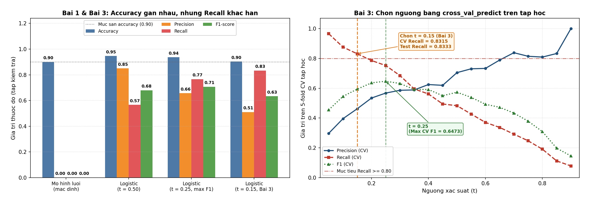
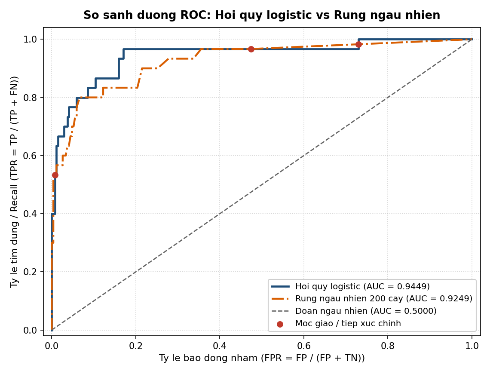
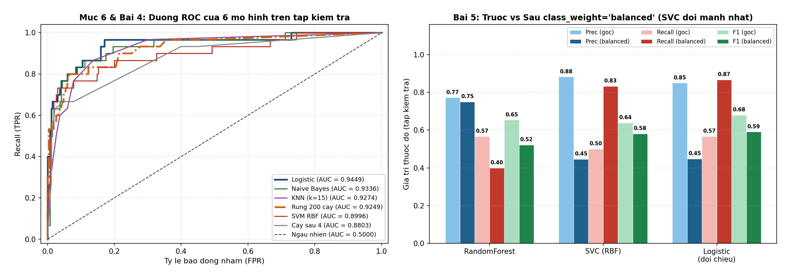
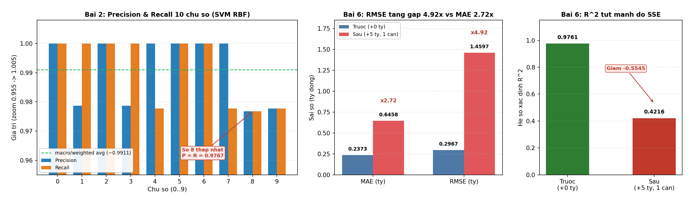

# Báo Cáo & Lời Giải Bài Tập Thực Hành 7: Đánh Giá Mô Hình

Tài liệu: `Lab07_DanhGiaMoHinh.pdf`  
Môn học: **Học máy ứng dụng** - Khoa Công nghệ Thông tin, Trường Đại học Văn Lang  
Giảng viên: **ThS. Nguyễn Thái Anh**  
Năm học: 2026 – 2027

---

## 📁 Cấu trúc thư mục

```text
07. Model_Evaluation/
├── data/
│   ├── sinh_vien_bo_hoc.csv                        # 1200 sinh viên (4 đặc trưng + nhãn bo_hoc lệch lớp ~9.9%)
│   └── gia_nha.csv                                 # 60 căn hộ (dien_tich, so_phong, tuoi_nha, gia — Bài 1)
├── baitap07/                                       # 6 bài tập tự luyện được yêu cầu nộp
│   ├── bai1.py                                     # Tự viết hàm danh_gia() bằng numpy & xử lý chia cho 0
│   ├── bai2.py                                     # classification_report cho 10 chữ số viết tay (SVM bài 6)
│   ├── bai3.py                                     # Chọn ngưỡng lớn nhất đạt recall >= 0.8 bằng cross_val_predict
│   ├── bai4.py                                     # Tự vẽ đường ROC (Logistic vs RandomForest) -> roc.png
│   ├── bai5.py                                     # Cân bằng lớp (class_weight="balanced") cho RandomForest & SVC
│   ├── bai6.py                                     # Tác động của 1 căn đoán hỏng +5 tỷ lên MAE, RMSE và R^2
│   ├── roc.png                                     # Biểu đồ ROC do bai4.py sinh ra theo yêu cầu đề bài
│   ├── screenshot_bai1.png -> screenshot_bai6.png  # Ảnh chụp màn hình kết quả chạy terminal PowerShell
│   ├── hinh_anh_ma_tran_va_nguong.png              # Biểu đồ so sánh thước đo (Bài 1) & chọn ngưỡng CV (Bài 3)
│   ├── hinh_anh_roc_va_can_bang.png                # Biểu đồ ROC 6 mô hình (Mục 6/Bài 4) & Cân bằng lớp (Bài 5)
│   ├── hinh_anh_chu_so_va_ngoai_lai.png            # Biểu đồ 10 chữ số (Bài 2) & Ảnh hưởng ngoại lai +5 tỷ (Bài 6)
│   └── README.md                                   # Báo cáo tổng hợp chi tiết
├── tao_anh_chup.py                                 # Script tự động chụp màn hình terminal PowerShell
└── ve_bieu_do.py                                   # Script vẽ các biểu đồ trực quan phân tích
```

### Cách thực thi các bài tập

Từ thư mục `07. Model_Evaluation`:
```bash
# Chạy từng bài tập trong thư mục baitap07 theo đúng yêu cầu đề bài
python baitap07/bai1.py
python baitap07/bai2.py
python baitap07/bai3.py
python baitap07/bai4.py
python baitap07/bai5.py
python baitap07/bai6.py
```
*(Các script sử dụng đường dẫn `data/...` đúng như yêu cầu đề bài, đồng thời có cơ chế dự phòng tự tìm tệp dữ liệu nếu chạy từ thư mục khác).*

---

## 📌 Tổng quan các con số kết quả chính

Bảng đối chiếu kết quả thực nghiệm với Phụ lục A (Bảng 5) của tài liệu thực hành `Lab07_DanhGiaMoHinh.pdf`:

| Đại lượng | Giá trị thực nghiệm | Ý nghĩa / Ghi chú |
|---|---|---|
| Tỷ lệ bỏ học (`sinh_vien_bo_hoc.csv`) | **`0.099`** (`119 / 1200`) | Dữ liệu lệch lớp (~10% lớp 1); tập test (`stratify=y`): `30 / 300` |
| Accuracy mô hình lười vs Logistic | **`0.9000`** vs **`0.9467`** | `0.9000` chỉ là mức sàn lớp đông; mô hình lười bỏ sót 30/30 bạn |
| Bốn ô TP, FP, FN, TN của Logistic (`t = 0.5`) | **`17, 3, 13, 267`** | Báo 20 bạn (đúng 17, nhầm 3), bỏ sót 13 bạn |
| Precision, Recall, F1 ở ngưỡng `0.5` | **`0.8500, 0.5667, 0.6800`** | Khớp tuyệt đối giữa hàm tự viết (`numpy`) và `scikit-learn` |
| Ngưỡng chọn bằng kiểm định chéo (Mục 5 — max F1) | **`0.25`** (CV F1 = `0.6473`) | Tập kiểm tra: `P = 0.6571, R = 0.7667, F1 = 0.7077` |
| Ngưỡng lớn nhất đạt `Recall >= 0.80` (Bài 3 — CV) | **`0.15`** (lưới `0.05`) | Tập kiểm tra: **`R = 0.8333`** (đạt), `P = 0.5102`, báo **`49`** bạn |
| AUC của Logistic vs Rừng ngẫu nhiên (Bài 4) | **`0.9449`** vs **`0.9249`** | Logistic thắng (`+0.0201`), ôm sát góc trên bên trái hơn |
| Recall kiểm định chéo 5 phần trên tập học (Mục 7) | **`0.4810`** | Accuracy CV `0.9289` cao nhưng thực tế sót hơn nửa lớp 1 |
| Logistic khi `class_weight="balanced"` (Mục 7) | **`P = 0.4483, R = 0.8667`** | F1 = `0.5909`; Recall tăng mạnh `+0.3000` giống hạ ngưỡng |
| Cân bằng lớp cho RF & SVC (Bài 5) | **SVC đổi mạnh nhất** | SVC: `R 0.5000 → 0.8333`, `P 0.8824 → 0.4464`; RF: `R 0.5667 → 0.4000` |
| Chữ số viết tay SVM (Bài 2) | Accuracy **`0.9911`** (`446/450`) | Số **`8`** có cả Precision (`0.9767`) và Recall (`0.9767`) thấp nhất |
| Cộng `+5 tỷ` vào 1 căn `gia_nha.csv` (Bài 6) | **RMSE tăng `4.92×`**, **MAE `2.72×`** | `RMSE: 0.2967 → 1.4597`, `MAE: 0.2373 → 0.6458`, $R^2$: `0.9761 → 0.4216` |

---

## 📝 Lời giải & Phân tích chi tiết từng bài tập

---

### Bài tập 1: Tự viết hàm đánh giá

#### 1. Yêu cầu đề bài
- Viết hàm `danh_gia(y_that, y_doan)` trả về `accuracy`, `precision`, `recall` và `F1`, chỉ dùng `numpy`.
- Chạy hàm cho mô hình logistic và cho mô hình lười ở mục 2, đối chiếu với các hàm của `scikit-learn`.
- Trả lời: Với mô hình lười, `precision` có tính được không? Hàm xử lý trường hợp chia cho 0 thế nào?

#### 2. Bảng đối chiếu kết quả thực nghiệm (300 sinh viên kiểm tra: 30 bỏ học, 270 không bỏ)

| Mô hình | TP | FP | FN | TN | Phương pháp | Accuracy | Precision | Recall | F1 |
|---|---:|---:|---:|---:|---|---:|---:|---:|---:|
| **Hồi quy logistic** | `17` | `3` | `13` | `267` | Tự viết (`numpy`) | `0.9467` | `0.8500` | `0.5667` | `0.6800` |
| | | | | | `scikit-learn` | `0.9467` | `0.8500` | `0.5667` | `0.6800` |
| **Mô hình lười** (`most_frequent`) | `0` | `0` | `30` | `270` | Tự viết (`numpy`) | `0.9000` | `0.0000` | `0.0000` | `0.0000` |
| | | | | | `scikit-learn` (`zero_division=0`) | `0.9000` | `0.0000` | `0.0000` | `0.0000` |

- Sai lệch lớn nhất giữa hàm tự viết bằng `numpy` và `scikit-learn` bằng **`0.0e+00`** (khớp hoàn toàn ở cả hai mô hình).

#### 3. Giải thích chi tiết từng ô ma trận nhầm lẫn & trường hợp chia cho 0
1. **Ý nghĩa bốn ô của hai mô hình**:
   - **Hồi quy logistic**: $\text{TP} = 17$ (báo đúng 17 bạn bỏ học), $\text{FP} = 3$ (báo động nhầm 3 bạn học tiếp), $\text{FN} = 13$ (bỏ sót 13 bạn bỏ học), $\text{TN} = 267$ (đoán đúng 267 bạn học tiếp). Do đó:
     $$\text{Precision} = \frac{17}{17 + 3} = 0.8500, \quad \text{Recall} = \frac{17}{17 + 13} = 0.5667, \quad F_1 = \frac{2 \times 0.8500 \times 0.5667}{0.8500 + 0.5667} = 0.6800$$
   - **Mô hình lười**: luôn đoán lớp `0` (không bỏ học) cho toàn bộ 300 sinh viên nên $\text{TP} = 0$, $\text{FP} = 0$, $\text{FN} = 30$, $\text{TN} = 270$. Accuracy đạt $270 / 300 = 0.9000$ (bằng đúng tỷ lệ lớp đông — chỉ là mức sàn), trong khi $\text{Recall} = 0 / (0 + 30) = 0.0000$ (bỏ sót 100% sinh viên cần hỗ trợ).
2. **Với mô hình lười, precision có tính được không?**:
   - **KHÔNG TÍNH ĐƯỢC (không xác định về mặt toán học)**. Vì mô hình lười không đưa ra bất kỳ dự đoán lớp dương (`1`) nào nên tổng số ca báo động là $\text{TP} + \text{FP} = 0 + 0 = 0$. Công thức $\text{Precision} = \frac{\text{TP}}{\text{TP} + \text{FP}} = \frac{0}{0}$ rơi vào phép **chia cho 0**.
   - Tương tự, khi cả Precision lẫn Recall đều bằng `0`, công thức $F_1 = \frac{2 \cdot P \cdot R}{P + R} = \frac{0}{0}$ cũng rơi vào dạng chia cho 0. Riêng $\text{Recall} = \frac{0}{0 + 30} = 0$ vẫn hoàn toàn xác định vì tập kiểm tra có 30 sinh viên bỏ học thật.
3. **Cách hàm `danh_gia()` xử lý chia cho 0**:
   - Kiểm tra điều kiện mẫu số dương trước mỗi phép chia:
     - `precision = tp / (tp + fp) if (tp + fp) > 0 else 0.0`
     - `recall = tp / (tp + fn) if (tp + fn) > 0 else 0.0`
     - `f1 = 2.0 * precision * recall / (precision + recall) if (precision + recall) > 0 else 0.0`
   - Cách xử lý này đảm bảo chương trình không bị lỗi `ZeroDivisionError` hay trả về `NaN`, khớp hoàn toàn với tham số `zero_division=0` trong `scikit-learn` (tránh cảnh báo `UndefinedMetricWarning`), đồng thời phản ánh đúng thực tế rằng mô hình lười không có năng lực phát hiện lớp bỏ học.

---

### Bài tập 2: Chữ số viết tay

#### 1. Yêu cầu đề bài
- Lấy lại SVM nhận dạng chữ số viết tay của bài 6 (`load_digits`, `test_size=0.25`, `random_state=17`, `stratify=y`, `SVC(kernel="rbf")`), in `classification_report` cho cả 10 chữ số.
- Cho biết chữ số nào có recall thấp nhất, chữ số nào có precision thấp nhất, và giải thích vì sao `macro avg` và `weighted avg` gần như bằng nhau trên bộ dữ liệu này.

#### 2. Bảng `classification_report` trên 450 ảnh kiểm tra

| Chữ số | Precision | Recall | F1-score | Support | Ghi chú lỗi (từ ma trận nhầm lẫn) |
|---|---:|---:|---:|---:|---|
| `0` | `1.0000` | `1.0000` | `1.0000` | `45` | Không sai |
| `1` | `0.9787` | `1.0000` | `0.9892` | `46` | 1 FP (ảnh số `8` bị đoán nhầm thành `1`) |
| `2` | `1.0000` | `1.0000` | `1.0000` | `44` | Không sai |
| `3` | `0.9787` | `1.0000` | `0.9892` | `46` | 1 FP (ảnh số `9` bị đoán nhầm thành `3`) |
| `4` | `1.0000` | `0.9778` | `0.9888` | `45` | 1 FN (ảnh số `4` bị đoán nhầm thành `8`) |
| `5` | `1.0000` | `1.0000` | `1.0000` | `46` | Không sai |
| `6` | `1.0000` | `1.0000` | `1.0000` | `45` | Không sai |
| `7` | `1.0000` | `0.9778` | `0.9888` | `45` | 1 FN (ảnh số `7` bị đoán nhầm thành `9`) |
| **`8`** | **`0.9767`** ⬇️ | **`0.9767`** ⬇️ | **`0.9767`** | `43` | 1 FN (`8 → 1`) và 1 FP (`4 → 8`) |
| `9` | `0.9778` | `0.9778` | `0.9778` | `45` | 1 FN (`9 → 3`) và 1 FP (`7 → 9`) |
| **accuracy** | | | **`0.9911`** | `450` | Đúng `446 / 450` ảnh (chỉ sai 4 ảnh) |
| **macro avg** | **`0.9912`** | **`0.9910`** | **`0.9911`** | `450` | Trung bình cộng đều trọng số $1/10 = 10\%$ |
| **weighted avg** | **`0.9912`** | **`0.9911`** | **`0.9911`** | `450` | Trung bình theo tỷ lệ `support / 450` |

#### 3. Trả lời & Giải thích
1. **Chữ số có Recall thấp nhất**: **Chữ số `8`** (`0.9767` = 42/43). Vì lớp `8` có ít ảnh kiểm tra nhất (`support = 43`) và bị bỏ sót 1 ảnh (`8 → 1`), nên một lỗi kéo recall giảm $1/43 = 0.0233$; trong khi các chữ số `4, 7, 9` cùng bỏ sót 1 ảnh nhưng có `support = 45` nên recall nhỉnh hơn (`44/45 = 0.9778`).
2. **Chữ số có Precision thấp nhất**: **Chữ số `8`** (`0.9767` = 42/43). Mô hình đoán 43 ảnh là số `8` (42 ảnh đúng + 1 ảnh số `4` báo nhầm thành `8`), đứng dưới chữ số `9` (`44/45 = 0.9778`) và `1, 3` (`46/47 = 0.9787`).
3. **Vì sao `macro avg` và `weighted avg` gần như bằng nhau?**:
   - Bộ `load_digits` có **10 lớp rất cân bằng**: `support` của mỗi chữ số trên tập kiểm tra chỉ dao động hẹp từ `43` đến `46` ảnh (chiếm `9.56%` đến `10.22%`, xấp xỉ mức chia đều `10.00%`).
   - Công thức `macro avg` gán trọng số bằng nhau $w_c = \frac{1}{10} = 0.100$ cho từng chữ số, còn `weighted avg` gán trọng số $w_c = \frac{\text{support}_c}{450} \in [0.0956, 0.1022]$. Khi các trọng số gần như bằng nhau và điểm số của cả 10 lớp đều cao đồng đều (`0.9767`–`1.0000`), hai phép trung bình này tất yếu gần như trùng khớp (chênh lệch tối đa chỉ `0.0001`).
   - *Đối chiếu*: Trên tập lệch lớp `sinh_vien_bo_hoc.csv` (tỷ lệ `270 : 30`, tức `90% : 10%` ở Mục 4), `macro avg` F1 (`0.8255`) và `weighted avg` F1 (`0.9418`) chênh nhau tới **`0.1163`** vì lớp đông chi phối mạnh `weighted avg`.

---

### Bài tập 3: Chọn ngưỡng theo yêu cầu

#### 1. Yêu cầu đề bài
- Nhà trường yêu cầu tìm ra ít nhất **80%** số bạn bỏ học (`Recall >= 0.80`).
- Dùng xác suất từ `cross_val_predict` trên tập học như mục 5, tìm ngưỡng **lớn nhất** cho recall từ `0.8` trở lên.
- Áp ngưỡng đó cho tập kiểm tra **một lần**. Kiểm tra xem recall có đạt `0.8` không, và báo cáo precision cùng số bạn bị báo.

#### 2. Bảng dò ngưỡng trên tập học bằng `cross_val_predict` (`cv=5`, 900 sinh viên — 89 bỏ học)

| Ngưỡng $t$ | Số báo (tập học) | TP / 89 | Precision (CV) | Recall (CV) | F1 (CV) | Đạt `Recall >= 0.80`? |
|---:|---:|---:|---:|---:|---:|---|
| `0.05` | `289` | `86 / 89` | `0.2976` | `0.9663` | `0.4550` | Đạt |
| `0.10` | `197` | `78 / 89` | `0.3959` | `0.8764` | `0.5455` | Đạt |
| **`0.15`** | **`160`** | **`74 / 89`** | **`0.4625`** | **`0.8315`** | **`0.5944`** | **ĐẠT ← CHỌN (lớn nhất)** |
| `0.20` | `131` | `70 / 89` | `0.5344` | `0.7865` | `0.6364` | Không |
| `0.25` | `118` | `67 / 89` | `0.5678` | `0.7528` | `0.6473` | Không (max F1 ở Mục 5) |
| `0.30` | `104` | `61 / 89` | `0.5865` | `0.6854` | `0.6321` | Không |

*(Trên đúng lưới ngưỡng bước `0.05` của Mục 5, ngưỡng lớn nhất đạt `Recall >= 0.80` là **`t = 0.15`**. Tham khảo thêm: nếu dùng lưới mịn bước `0.01` trên cùng `xs_hoc`, ngưỡng lớn nhất là `t = 0.17` với CV Recall `0.8090` và CV Precision `0.5070`).*

#### 3. Kết quả khi áp ngưỡng `t = 0.15` cho tập kiểm tra (đúng một lần)

| Đại lượng trên tập kiểm tra (300 bạn, 30 bỏ học) | Kết quả (`t = 0.15`, lưới `0.05`) | Tham khảo (`t = 0.17`, lưới `0.01`) |
|---|---:|---:|
| Bốn ô ma trận nhầm lẫn (`TP, FP, FN, TN`) | **`25, 24, 5, 246`** | `24, 23, 6, 247` |
| **Số sinh viên bị báo nguy cơ (`TP + FP`)** | **`49` bạn** (`16.3%`) | `47` bạn (`15.7%`) |
| **Recall** | **`0.8333`** (`25 / 30`) | `0.8000` (`24 / 30`) |
| **Precision** | **`0.5102`** (`25 / 49`) | `0.5106` (`24 / 47`) |
| **F1-score** | **`0.6329`** | `0.6234` |
| **Có đạt yêu cầu `Recall >= 0.80` không?** | **CÓ ĐẠT** (`0.8333 >= 0.80`) | **CÓ ĐẠT** (`0.8000 >= 0.80`) |

#### 4. Giải thích nguyên tắc chọn ngưỡng không nhìn tập kiểm tra
1. **Vì sao phải chọn ngưỡng LỚN NHẤT thỏa `Recall >= 0.80`?**: Khi hạ ngưỡng càng thấp, Recall tăng nhưng Precision giảm mạnh và số báo động nhầm (`FP`) tăng vọt. Chọn ngưỡng **lớn nhất** vẫn thỏa `Recall >= 0.80` giúp đáp ứng đúng yêu cầu không bỏ sót của nhà trường đồng thời giữ Precision cao nhất có thể, tránh lãng phí nguồn lực tư vấn cho những sinh viên không có nguy cơ.
2. **Vì sao bắt buộc dùng `cross_val_predict` trên tập học và không nhìn tập kiểm tra?**:
   - Nếu chọn ngưỡng bằng cách nhìn bảng kết quả trên tập kiểm tra, tập kiểm tra đã bị dùng để ra quyết định (**rò rỉ dữ liệu — data leakage**), khiến điểm báo cáo đẹp giả tạo hơn thực tế khi triển khai cho khóa mới.
   - `cross_val_predict(cv=5)` cấp cho mỗi sinh viên trong tập học một xác suất **ngoài mẫu (out-of-fold)** từ mô hình chưa từng nhìn thấy bạn ấy, phản ánh trung thực cách mô hình hoạt động trên sinh viên mới.
3. **Đánh đổi thực tế**: Với `t = 0.15`, mô hình tìm được **25/30** sinh viên bỏ học (chỉ bỏ sót 5 bạn), đổi lại nhà trường cần gọi tư vấn **49 bạn** (trong đó có 24 báo động nhầm, `Precision = 0.5102`). Vì tập kiểm tra chỉ có 30 ca bỏ học (mỗi 1 bạn ứng với `3.33%`), Recall trên tập kiểm tra luôn có thể dao động nhẹ quanh mức đo trên tập học.



---

### Bài tập 4: Tự vẽ đường ROC

#### 1. Yêu cầu đề bài
- Dùng `roc_curve` lấy hai mảng `fpr` và `tpr` của hồi quy logistic và của rừng ngẫu nhiên (`RandomForestClassifier(200, random_state=0)`).
- Vẽ cả hai đường cùng đường chéo đoán ngẫu nhiên lên một hình bằng `plt.plot`, ghi `AUC` vào chú thích, lưu thành `roc.png`.
- Cho biết đường nào ôm sát góc trên bên trái hơn và có đoạn nào hai đường cắt nhau không.

#### 2. Biểu đồ `roc.png` & So sánh định lượng



| Mô hình | Số điểm ROC | AUC | FPR cần để đạt Recall `0.8667` | FPR cần để đạt Recall `0.9667` |
|---|---:|---:|---:|---:|
| **Hồi quy logistic** (`StandardScaler + LR`) | `28` | **`0.9449`** | **`0.1037`** (28 báo nhầm) | **`0.1704`** (46 báo nhầm) |
| **Rừng ngẫu nhiên** (`200 cây`) | `46` | `0.9249` | `0.2111` (57 báo nhầm) | `0.3556` (96 báo nhầm) |

#### 3. Trả lời & Phân tích đoạn cắt nhau
1. **Đường nào ôm sát góc trên bên trái hơn?**:
   - **Đường hồi quy logistic** (`AUC = 0.9449`) ôm sát góc trên bên trái rõ rệt hơn so với rừng ngẫu nhiên (`AUC = 0.9249`, hơn `+0.0201`).
   - Đặc biệt trong vùng vận hành thực tế quan trọng nhất (`FPR ∈ [0.011, 0.356]`), đường Logistic nằm cao hơn rõ rệt: chỉ cần `FPR = 0.1704` đã đạt `Recall = 0.9667` (29/30 bạn bỏ học), trong khi Rừng ngẫu nhiên phải chấp nhận gấp đôi báo động nhầm (`FPR = 0.3556`) mới đạt cùng mức Recall này.
2. **Có đoạn nào hai đường cắt nhau không?**:
   - **CÓ**, hai đường cắt nhau ở **hai vùng** rõ rệt (đã kiểm chứng trên lưới dày `FPR ∈ [0, 1]`):
     - **Vùng đầu đường (`FPR ∈ [0.0037, 0.0074]`)**: Tại `FPR = 0`, Logistic lên `Recall = 0.4000` (cao hơn RF `0.3000`). Nhưng ngay tại `FPR = 0.0037` (chỉ 1 báo nhầm), RF nhảy vọt lên `Recall = 0.5333` vượt qua Logistic (`0.4000`); tới `FPR = 0.0074`, Logistic đuổi kịp `0.5333` rồi vượt hẳn lên trên từ `FPR >= 0.0111`.
     - **Vùng đuôi đường (`FPR ∈ [0.4741, 0.7296]`)**: Hai đường cùng nằm ngang ở `Recall = 0.9667` trên `[0.3556, 0.4741]`, sau đó từ `FPR = 0.4741` đường RF nối chéo đi thẳng lên `(1.0, 1.0)` (vì nhiều mẫu có cùng xác suất bằng 0 trong rừng 200 cây), hơi nhỉnh hơn đường ngang của Logistic cho tới `FPR = 0.7296`, khi Logistic nhảy lên `Recall = 1.0000` và quay lại nằm trên RF.

---

### Bài tập 5: Cân bằng lớp cho mô hình khác

#### 1. Yêu cầu đề bài
- Thêm `class_weight="balanced"` cho `RandomForestClassifier` và cho `SVC`.
- So sánh `precision`, `recall`, `F1` trên tập kiểm tra trước và sau khi cân bằng, và cho biết mô hình nào thay đổi nhiều nhất.

#### 2. Bảng so sánh trước và sau `class_weight="balanced"` trên tập kiểm tra

| Mô hình | Chế độ | Precision | Recall | F1 | TP | FP | FN | Tổng biên độ $\|\Delta P\| + \|\Delta R\| + \|\Delta F_1\|$ |
|---|---|---:|---:|---:|---:|---:|---:|---:|
| **RandomForest (200 cây)** | Bình thường | `0.7727` | `0.5667` | `0.6538` | `17` | `5` | `13` | — |
| | `balanced` | `0.7500` | `0.4000` | `0.5217` | `12` | `4` | `18` | — |
| | *Thay đổi* | `-0.0227` | `-0.1667` | `-0.1321` | `-5` | `-1` | `+5` | `0.3215` |
| **SVC (RBF + Scaler)** | Bình thường | `0.8824` | `0.5000` | `0.6383` | `15` | `2` | `15` | — |
| | `balanced` | **`0.4464`** | **`0.8333`** | **`0.5814`** | `25` | `31` | `5` | — |
| | *Thay đổi* | **`-0.4359`** | **`+0.3333`** | `-0.0569` | `+10` | `+29` | `-10` | **`0.8261`** ⭐ |
| *Logistic (Mục 7, đối chiếu)* | Bình thường | `0.8500` | `0.5667` | `0.6800` | `17` | `3` | `13` | — |
| | `balanced` | `0.4483` | `0.8667` | `0.5909` | `26` | `32` | `4` | `0.7908` |

#### 3. Nhận xét & Giải thích cơ chế
1. **Mô hình thay đổi nhiều nhất**: **`SVC (RBF + Scaler)`** thay đổi mạnh nhất ở cả Precision (`-0.4359`, từ `0.8824` xuống `0.4464`) lẫn Recall (`+0.3333`, từ `0.5000` nhảy vọt lên `0.8333`, phát hiện thêm 10 bạn bỏ học, đồng thời FP tăng từ 2 lên 31). Tổng biên độ biến động của `SVC` (`0.8261`) lớn hơn gấp **~2.6 lần** so với `RandomForest` (`0.3215`).
2. **Vì sao `SVC` phản ứng mạnh giống `Logistic`, còn `RandomForest` thì ngược lại?**:
   - **Với `SVC`**: `class_weight="balanced"` nhân trực tiếp hệ số phạt $C$ của từng lớp theo tỷ lệ nghịch tần suất (trọng số lớp `1` là `5.06`, lớp `0` là `0.56` — phạt sai sinh viên bỏ học nặng gấp **~9.1 lần**). Siêu phẳng lề bị đẩy mạnh về phía lớp đông để bảo vệ lớp hiếm, tạo hiệu ứng tương đương hạ ngưỡng xác suất mạnh.
   - **Với `RandomForestClassifier` (cây mọc hết chiều sâu mặc định)**: các cây quyết định chia nhánh đến tận các lá thuần khiết (mỗi lá chỉ chứa 1 lớp). Khi thêm trọng số `balanced`, tiêu chí Gini tách riêng nhóm nhỏ bỏ học sớm hơn tạo ra các nhánh hẹp dễ học vẹt mẫu hiếm trên tập học; kết quả trên tập kiểm tra số phiếu bầu lớp 1 ở các điểm biên lại giảm, khiến Recall thực tế giảm từ `0.5667` xuống `0.4000` (`TP: 17 → 12`).
   - **Bài học thực tế**: `class_weight="balanced"` phát huy tác dụng rất rõ trên các mô hình tối ưu hàm mất mát / lề (`LogisticRegression`, `SVC`); còn với `RandomForest`, muốn tăng Recall nên **hạ ngưỡng `predict_proba`** (như Bài 3) hoặc kết hợp giới hạn độ sâu cây (`max_depth`, `min_samples_leaf`).



---

### Bài tập 6: MAE và RMSE với một lần đoán hỏng

#### 1. Yêu cầu đề bài
- Trên dữ liệu giá nhà của bài 1 (`data/gia_nha.csv`, 60 căn hộ, 3 đặc trưng `dien_tich, so_phong, tuoi_nha`, chia `test_size=0.2, random_state=42` ra 48 căn học và 12 căn kiểm tra), tính `MAE`, `RMSE` và $R^2$ của hồi quy tuyến tính trên tập kiểm tra.
- Cộng thêm **5 tỷ** vào dự đoán của đúng một căn (căn đầu tiên trong tập kiểm tra: giá thật `3.00` tỷ, dự đoán gốc `2.95` tỷ → dự đoán hỏng `7.95` tỷ), rồi tính lại cả ba con số.
- Cho biết con số nào thay đổi nhiều nhất và giải thích vì sao `RMSE` phạt nặng sai số lớn hơn `MAE`.

#### 2. Bảng so sánh trước và sau khi cộng `+5 tỷ` cho đúng 1 căn

| Thước đo | Trước (`+0 tỷ`) | Sau (`+5 tỷ`, 1 căn) | Chênh lệch | Tỷ lệ / Mức thay đổi | Tỷ trọng đóng góp của 1 căn hỏng |
|---|---:|---:|---:|---:|---:|
| **MAE (tỷ)** | `0.2373` | `0.6458` | `+0.4086` | gấp **`2.72×`** (`+172.2%`) | `63.9%` tổng $\sum \|e_i\|$ |
| **RMSE (tỷ)** | `0.2967` | **`1.4597`** | **`+1.1630`** | gấp **`4.92×`** (**`+391.9%`**) ⭐ | **`95.9%`** tổng $\sum e_i^2$ |
| **$R^2$** | `0.9761` | **`0.4216`** | **`-0.5545`** | giảm **`56.8%`** giá trị | Dùng chung tổng $\text{SSE} = n \cdot \text{RMSE}^2$ |

#### 3. Trả lời & Giải thích toán học
1. **Con số nào thay đổi nhiều nhất?**:
   - Xét giữa hai thước đo sai số cùng đơn vị (tỷ đồng): **`RMSE` thay đổi mạnh nhất**, tăng vọt gấp **`4.92 lần`** (`+391.9%`, từ `0.2967` lên `1.4597` tỷ), trong khi `MAE` chỉ tăng gấp `2.72 lần` (`+172.2%`, từ `0.2373` lên `0.6458` tỷ).
   - Kéo theo đó, **$R^2$ cũng bị đánh gục cực nặng** (tụt từ `0.9761` xuống còn `0.4216`, mất `-0.5545` — hơn một nửa phương sai giải thích được), bởi công thức $R^2 = 1 - \frac{\sum e_i^2}{\sum (y_i - \bar{y})^2}$ cũng phụ thuộc trực tiếp vào tổng bình phương sai số $\text{SSE} = n \cdot \text{RMSE}^2$.
2. **Giải thích vì sao RMSE phạt nặng sai số lớn hơn MAE**:
   - **MAE** lấy trung bình **tuyến tính (bậc 1)** các sai số tuyệt đối:
     $$\text{MAE} = \frac{1}{n} \sum_{i=1}^{n} |e_i|$$
     Khi 1 căn trên $n = 12$ căn bị lệch thêm $\Delta = 5$ tỷ, sai số này được chia đều cho cả 12 căn, nên MAE chỉ tăng tối đa $\frac{5}{12} \approx 0.4167$ tỷ (thực tế tăng `+0.4086` tỷ).
   - **RMSE** **bình phương (bậc 2)** từng sai số trước khi lấy trung bình rồi mới khai căn:
     $$\text{RMSE} = \sqrt{\frac{1}{n} \sum_{i=1}^{n} e_i^2}$$
     Một sai số $|e_0| \approx 4.95$ tỷ khi bình phương lên thành $e_0^2 \approx 24.53$, chiếm tới **`95.9%`** tổng bình phương sai số của cả 12 căn hộ! Ngay cả sau khi chia cho $12$ và lấy căn bậc hai, riêng căn hỏng này đã đẩy RMSE lên xấp xỉ $\frac{5}{\sqrt{12}} \approx 1.4434$ tỷ (thực tế đạt `1.4597` tỷ) — mạnh hơn mức tác động lên MAE đúng hệ số $\sqrt{n} = \sqrt{12} \approx \mathbf{3.46\text{ lần}}$.
   - **Kết luận**: Dùng **RMSE** khi các dự đoán lệch nặng gây hậu quả nghiêm trọng và cần phạt mạnh; dùng **MAE** khi muốn đo sai số điển hình ít bị bóp méo bởi một vài điểm ngoại lai cá biệt.



---

## 🖼️ Ảnh chụp màn hình kết quả chạy thực tế

Toàn bộ 6 ảnh chụp màn hình terminal PowerShell đã được tự động tạo và lưu trong thư mục `baitap07/`:

| Bài tập | Tệp ảnh kết quả | Nội dung kiểm chứng |
|---|---|---|
| **Bài 1** | `baitap07/screenshot_bai1.png` | Hàm `danh_gia()` thuần numpy khớp 100% sklearn cho Logistic & Mô hình lười + giải thích chia 0 |
| **Bài 2** | `baitap07/screenshot_bai2.png` | `classification_report` 10 chữ số, xác định số `8` thấp nhất (P=R=0.9767) & giải thích macro vs weighted |
| **Bài 3** | `baitap07/screenshot_bai3.png` | Bảng dò ngưỡng CV tập học (`t = 0.15`), đánh giá 1 lần trên test (Recall 0.8333 đạt, P 0.5102, 49 báo) |
| **Bài 4** | `baitap07/screenshot_bai4.png` | So sánh AUC Logistic (`0.9449`) vs RF (`0.9249`), lưu `roc.png` & chỉ rõ 2 vùng cắt nhau |
| **Bài 5** | `baitap07/screenshot_bai5.png` | Bảng so sánh trước/sau `class_weight="balanced"` cho RF, SVC (đổi mạnh nhất) và đối chiếu Logistic |
| **Bài 6** | `baitap07/screenshot_bai6.png` | Bảng MAE (`2.72×`), RMSE (`4.92×`), $R^2$ (`0.9761 → 0.4216`) khi cộng +5 tỷ cho 1 căn + giải thích |

---

## 💡 Phụ lục: Các lỗi thường gặp và cách xử lý khi đánh giá mô hình

Trích từ Phụ lục B (Bảng 6) tài liệu thực hành `Lab07_DanhGiaMoHinh.pdf`:

1. **`UndefinedMetricWarning: Precision is ill-defined`**:
   - *Nguyên nhân*: Mô hình không báo mẫu nào là lớp dương nên $\text{TP} + \text{FP} = 0$.
   - *Cách xử lý*: Thêm `zero_division=0` trong `precision_score` / `f1_score` (hoặc kiểm tra mẫu số trước khi chia như trong Bài 1).
2. **Precision và Recall bị đổi chỗ cho nhau**:
   - *Nguyên nhân*: Truyền ngược thứ tự tham số `(du_doan, y_te)` thay vì `(y_te, du_doan)`.
   - *Cách xử lý*: Luôn viết **nhãn thật trước, nhãn đoán sau**: `recall_score(y_te, du_doan)`.
3. **Số liệu các ô ma trận nhầm lẫn bị lệch**:
   - *Nguyên nhân*: Trải ma trận sai thứ tự (ví dụ viết nhầm `tp, fp, fn, tn = m.ravel()`).
   - *Cách xử lý*: Thứ tự chuẩn của `scikit-learn` luôn là `tn, fp, fn, tp = confusion_matrix(y_te, du_doan).ravel()`.
4. **Recall của lớp hiếm bằng 0 dù accuracy cao**:
   - *Nguyên nhân*: Dữ liệu lệch lớp nên mô hình đang đoán mọi mẫu là lớp đông.
   - *Cách xử lý*: Hạ ngưỡng quyết định từ `predict_proba` (trên tập học qua `cross_val_predict`) hoặc dùng `class_weight="balanced"`.
5. **`AttributeError: predict_proba is not available`**:
   - *Nguyên nhân*: `SVC` mặc định không tính xác suất.
   - *Cách xử lý*: Truyền `SVC(probability=True)` hoặc dùng `decision_function` cho `roc_auc_score`.
6. **Tập kiểm tra có quá ít (hoặc dao động mạnh) số mẫu lớp hiếm**:
   - *Nguyên nhân*: Quên `stratify=y` khi gọi `train_test_split`.
   - *Cách xử lý*: Luôn truyền `stratify=y` cho bài toán phân loại, nhất là khi dữ liệu lệch lớp.
7. **Điểm báo cáo đẹp hơn thực tế khi đem dùng thật**:
   - *Nguyên nhân*: Đã chọn ngưỡng hoặc tham số bằng cách nhìn kết quả trên tập kiểm tra (rò rỉ dữ liệu).
   - *Cách xử lý*: Chỉ chọn ngưỡng và tham số bằng kiểm định chéo (`cross_val_predict` / `GridSearchCV`) trên tập học; chỉ mở tập kiểm tra **đúng một lần** ở bước đánh giá cuối cùng.
