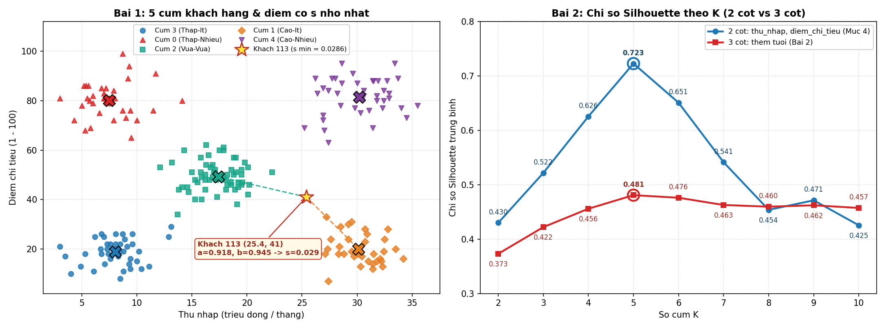
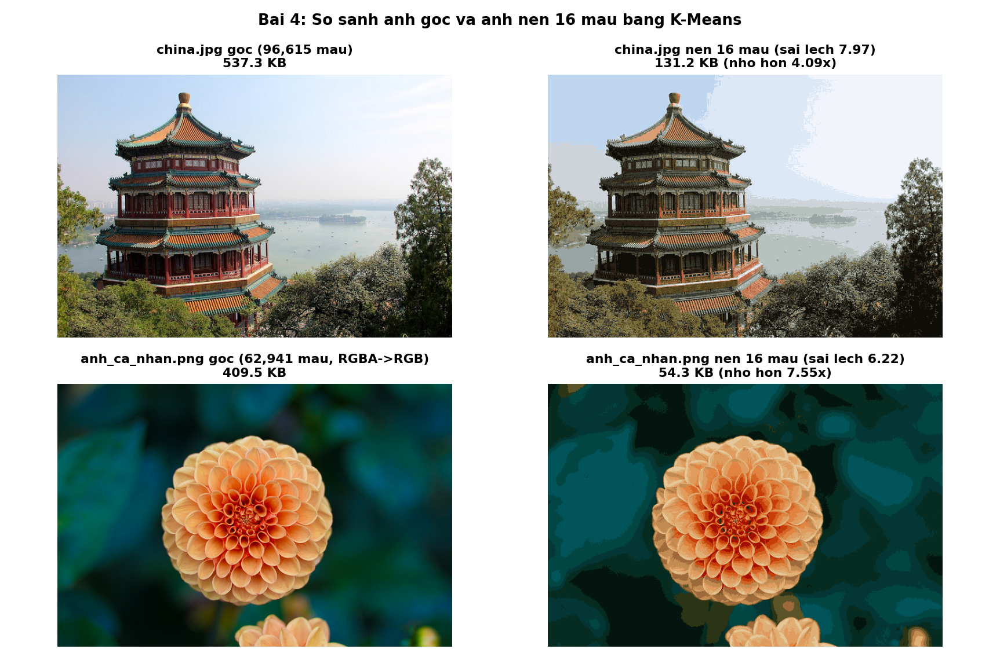
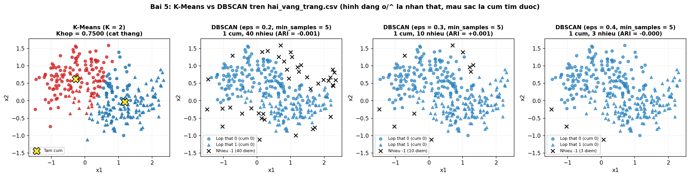
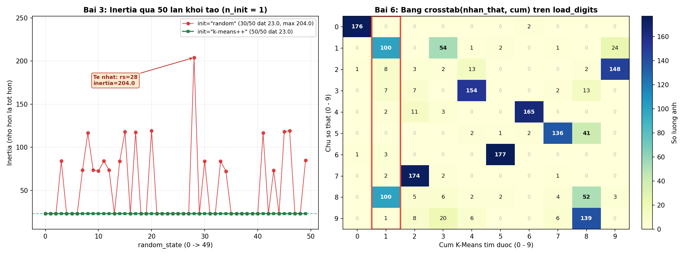

# Báo Cáo & Lời Giải Bài Tập Thực Hành 8: Phân Cụm K-Means

Tài liệu: `Lab08_KMeans.pdf`  
Môn học: **Học máy ứng dụng** - Khoa Công nghệ Thông tin, Trường Đại học Văn Lang  
Giảng viên: **ThS. Nguyễn Thái Anh**  
Năm học: 2026 – 2027

---

## 📁 Cấu trúc thư mục

```text
08. KMeans/
├── data/
│   ├── khach_hang.csv                              # Dữ liệu 210 khách hàng (tuổi, thu nhập, điểm chi tiêu; không nhãn)
│   └── hai_vang_trang.csv                          # Dữ liệu 300 điểm hai vầng trăng (x1, x2, nhan)
├── baitap08/                                       # 6 bài tập tự luyện được yêu cầu nộp
│   ├── bai1.py                                     # Tự tính chỉ số silhouette bằng numpy & phân tích điểm s nhỏ nhất
│   ├── bai2.py                                     # Phân cụm trên cả 3 cột (thêm cột tuổi) & chọn lại K
│   ├── bai3.py                                     # So sánh K-Means++ và khởi tạo ngẫu nhiên trên 50 lần chạy
│   ├── bai4.py                                     # Nén & lưu ảnh 16 màu (china.jpg và ảnh cá nhân PNG 4 kênh RGBA)
│   ├── bai5.py                                     # Chạy DBSCAN (eps = 0.2, 0.3, 0.4) trên bộ hai vầng trăng
│   ├── bai6.py                                     # Phân cụm 1797 ảnh chữ số viết tay load_digits (K = 10)
│   ├── screenshot_bai1.png -> screenshot_bai6.png  # Ảnh chụp màn hình kết quả chạy terminal PowerShell
│   ├── anh_goc.png                                 # Ảnh gốc china.jpg lưu dạng PNG (537.3 KB)
│   ├── anh_16_mau.png                              # Ảnh china.jpg nén còn 16 màu (131.2 KB)
│   ├── anh_ca_nhan.png                             # Ảnh cá nhân PNG 4 kênh RGBA đọc bằng plt.imread (409.5 KB)
│   ├── anh_ca_nhan_16_mau.png                      # Ảnh cá nhân sau khi bỏ kênh Alpha và nén còn 16 màu (54.3 KB)
│   ├── bai4_so_sanh_nen_anh.png                    # Hình đối chiếu 2×2 ảnh gốc vs ảnh 16 màu (Bài 4)
│   ├── hinh_anh_silhouette_va_3cot.png             # Biểu đồ 5 cụm + khách 113 (Bài 1) & Silhouette 2 cột vs 3 cột (Bài 2)
│   ├── hinh_anh_dbscan_hai_vang_trang.png          # Biểu đồ K-Means vs DBSCAN (eps = 0.2, 0.3, 0.4) trên hai vầng trăng (Bài 5)
│   ├── hinh_anh_khoi_tao_va_digits.png             # Biểu đồ 50 lần khởi tạo (Bài 3) & Heatmap crosstab load_digits (Bài 6)
│   └── README.md                                   # Báo cáo tổng hợp chi tiết
├── tao_anh_chup.py                                 # Script tự động chụp màn hình terminal PowerShell
└── ve_bieu_do.py                                   # Script vẽ các biểu đồ trực quan phân tích
```

### Cách thực thi các bài tập

Từ thư mục `08. KMeans`:
```bash
# Chạy từng bài tập trong thư mục baitap08 theo đúng yêu cầu đề bài
python baitap08/bai1.py
python baitap08/bai2.py
python baitap08/bai3.py
python baitap08/bai4.py
python baitap08/bai5.py
python baitap08/bai6.py
```
*(Các script sử dụng đường dẫn `data/...` đúng như yêu cầu đề bài, đồng thời có cơ chế dự phòng tự tìm tệp dữ liệu nếu chạy từ thư mục khác).*

---

## 📌 Tổng quan các con số kết quả chính

Bảng đối chiếu kết quả thực nghiệm với Phụ lục A (Bảng 5) của tài liệu thực hành:

| Đại lượng | Giá trị thực nghiệm | Ý nghĩa / Ghi chú |
|---|---|---|
| Bảy điểm (Mục 2): số vòng lặp / inertia | **3 vòng** / **`8.5250`** | Tự viết bằng numpy khớp hoàn toàn với `KMeans` |
| Khách hàng (`K = 5`, 2 cột): inertia | **`23.02`** (~`23.0`) | Silhouette đạt đỉnh **`0.723`** (`0.722706`) ở $K = 5$ |
| Silhouette theo $K = 4, 5, 6$ (2 cột) | **`0.626, 0.723, 0.651`** | Khớp chính xác Phụ lục A; tự tính numpy chênh $1.11 \times 10^{-16}$ |
| Khách hàng có $s$ nhỏ nhất (Bài 1) | **Khách #113** (`25.4, 41`) | $a = 0.9178$, $b = 0.9448 \implies s = \mathbf{0.0286}$ (giữa Cụm 3 & 4 Hình 3) |
| Thêm cột tuổi — 3 cột (Bài 2) | $K$ tốt nhất vẫn là **`5`** | Silhouette giảm `0.7227 → 0.4808` (sát $K=6$: `0.4760`); chỉ 5/210 khách đổi cụm |
| 50 lần chạy `n_init=1` (Bài 3) | `random`: **30/50** / `k-means++`: **50/50** | `k-means++` đạt `23.0` **100%**; `random` bị tệ **40%** (max **`204.05`**) |
| Nén ảnh `china.jpg` 16 màu (Bài 4) | **`537.3 KB → 131.2 KB`** (`4.09×`) | Sai lệch TB **`7.97`** mức sáng (lý thuyết thô 24→4 bit là **`6.0×`**) |
| Nén ảnh cá nhân RGBA 16 màu (Bài 4) | **`409.5 KB → 54.3 KB`** (`7.55×`) | Cắt bỏ kênh Alpha thứ 4 `(427,640,4) → (427,640,3)`; sai lệch **`6.22`** |
| DBSCAN trên hai vầng trăng (Bài 5) | `eps=0.2/0.3/0.4`: **1 cụm** (`40/10/3` nhiễu) | Không tách tốt hơn K-Means (`0.7500`) do nhiễu cao tạo cầu nối mật độ |
| Phân cụm `load_digits` $K=10$ (Bài 6) | Purity **`79.19%`** / ARI **`0.6657`** | Gom gọn nhất: **0, 6, 7, 4** (>91%); gom chung mạnh nhất: **1 & 8** (100/100) |

---

## 📝 Lời giải & Phân tích chi tiết từng bài tập

---

### Bài tập 1: Tự tính silhouette

#### 1. Yêu cầu đề bài
- Viết hàm `silhouette_mot_diem(X, nhan, i)` tính $a$, $b$ và $s$ của điểm thứ $i$ theo đúng định nghĩa ở mục 4, **chỉ dùng numpy**.
- Chạy hàm cho mọi khách hàng với $K = 5$, lấy trung bình rồi so sánh với `silhouette_score`.
- Cho biết khách nào có $s$ nhỏ nhất và khách đó nằm ở đâu trên Hình 3.

#### 2. Công thức & Kiểm chứng với `scikit-learn`
Với mỗi điểm $x_i$ thuộc cụm $C(i)$ trong không gian đã chuẩn hoá (`StandardScaler` trên 2 cột `thu_nhap`, `diem_chi_tieu`):
$$a(i) = \frac{1}{|C(i)| - 1} \sum_{\substack{j \in C(i) \\ j \ne i}} \|x_i - x_j\|_2, \qquad b(i) = \min_{C_k \ne C(i)} \left( \frac{1}{|C_k|} \sum_{j \in C_k} \|x_i - x_j\|_2 \right), \qquad s(i) = \frac{b(i) - a(i)}{\max\big(a(i), b(i)\big)}$$

- **Silhouette trung bình tự tính (numpy)**: **`0.722706`**
- **Silhouette của `sklearn.metrics.silhouette_score`**: **`0.722706`**
- **Chênh lệch tuyệt đối trung bình**: `1.11e-16` (sai khác lớn nhất trên cả 210 điểm chỉ `9.99e-16`, trùng khớp hoàn toàn ở mức sai số dấu phẩy động 64-bit).

#### 3. Top 5 khách hàng có chỉ số silhouette ($s$) nhỏ nhất

| Chỉ số | Tuổi | Thu nhập (triệu) | Điểm chi tiêu | Cụm máy | $a(i)$ | $b(i)$ | $s(i)$ |
|---|---|---|---|---|---|---|---|
| **`113`** | `38` | **`25.4`** | **`41`** | `2` (Hình 3: Cụm 3) | `0.9178` | `0.9448` | **`0.0286`** |
| `70` | `33` | `13.7` | `34` | `2` (Hình 3: Cụm 3) | `0.7337` | `0.8312` | `0.1173` |
| `205` | `39` | `13.1` | `29` | `3` (Hình 3: Cụm 1) | `0.6847` | `0.9058` | `0.2440` |
| `165` | `54` | `27.4` | `63` | `4` (Hình 3: Cụm 5) | `0.8157` | `1.1704` | `0.3031` |
| `105` | `28` | `25.2` | `69` | `4` (Hình 3: Cụm 5) | `0.7635` | `1.1133` | `0.3143` |

#### 4. Giải thích ý nghĩa Silhouette & Vị trí khách #113 trên Hình 3
- **Khách hàng có $s$ nhỏ nhất**: **Khách chỉ số `113`** (dòng 115 trong `khach_hang.csv`), có `tuoi = 38`, **`thu_nhap = 25.4` triệu**, **`diem_chi_tieu = 41`**, được gán vào **cụm 2** (*Thu nhập vừa, chi vừa* — tâm `(17.4, 49.3)`), có cụm láng giềng gần nhất là **cụm 1** (*Thu nhập cao, chi ít* — tâm `(30.1, 20.0)`).
- **Vị trí trên Hình 3**: Khách này là điểm vuông màu xanh ngọc nằm **đơn độc, lơ lửng ngay khoảng trống giữa Cụm 3** (cụm ở chính giữa, thu nhập ~17.4, chi tiêu ~49.3) **và Cụm 4** (cụm góc dưới bên phải, thu nhập ~30.1, chi tiêu ~20.0).
- **Giải thích bằng bản chất $a, b, s$**:
  - $a$ đo độ gắn kết **nội cụm** (nhỏ = nằm gọn trong cụm của mình); $b$ đo độ tách biệt **ngoại cụm** (lớn = cách xa cụm gần nhất khác).
  - Do khách #113 nằm xa lõi của cả hai cụm và rơi sát đường ranh giới chia đôi giữa Cụm 3 và Cụm 4, khoảng cách trung bình tới các điểm cùng cụm ($a = 0.9178$) **gần bằng** khoảng cách trung bình tới cụm láng giềng ($b = 0.9448$). Vì thế hiệu $b - a = 0.0270$ rất nhỏ, kéo $s = \frac{0.0270}{0.9448} = \mathbf{0.0286} \approx 0$.
  - Vì $s > 0$ ($a < b$), K-Means vẫn gán đúng về cụm gần hơn, nhưng giá trị gần 0 phản ánh đây là một khách hàng **chuyển tiếp / ngoại lệ** nằm giữa hai phân khúc.

---

### Bài tập 2: Thêm cột tuổi

#### 1. Yêu cầu đề bài
- Phân cụm trên cả ba cột `tuoi`, `thu_nhap` và `diem_chi_tieu` (có chuẩn hoá `StandardScaler`).
- Chọn lại $K$ bằng chỉ số silhouette với $K$ từ `2` tới `10`.
- Trả lời: $K$ tốt nhất có còn là `5` không? Tâm các cụm thay đổi thế nào so với mục 3?

#### 2. Bảng kết quả chọn $K$ trên 3 cột (`K = 2..10`)

| $K$ | Inertia (3 cột) | Giảm so với $K-1$ | Silhouette (3 cột) | Đối chiếu Silhouette (2 cột, Mục 4) |
|---|---|---|---|---|
| `2` | `373.51` | — | `0.3730` | `0.430` |
| `3` | `271.81` | `101.70` | `0.4220` | `0.522` |
| `4` | `187.22` | `84.58` | `0.4558` | `0.626` |
| **`5`** | **`133.46`** | **`53.76`** | **`0.4808`** ⭐ | **`0.723`** ⭐ |
| `6` | `108.88` | `24.58` | `0.4760` | `0.651` |
| `7` | `92.96` | `15.92` | `0.4627` | `0.541` |
| `8` | `80.70` | `12.26` | `0.4596` | `0.454` |
| `9` | `69.58` | `11.12` | `0.4622` | `0.471` |
| `10` | `58.40` | `11.18` | `0.4573` | `0.425` |

#### 3. So sánh tâm cụm theo đơn vị gốc giữa Mục 3 (2 cột) và Bài 2 (3 cột) với `K = 5`

| Phân khúc khách hàng | Mục 3 (2 cột): `(tuổi, thu nhập, chi tiêu, số khách)` | Bài 2 (3 cột): `(tuổi, thu nhập, chi tiêu, số khách)` | Thay đổi |
|---|---|---|---|
| **Thu nhập thấp, chi ít** | `(44.9, 8.0, 18.9, 40)` | `(44.9, 8.0, 18.9, 40)` | **Không đổi** |
| **Thu nhập thấp, chi nhiều (trẻ)** | `(24.9, 7.5, 80.2, 35)` | **`(25.1, 8.5, 77.6, 39)`** | `+4` khách trẻ (26–27 tuổi), thu nhập `+1.0`, chi tiêu `-2.6` |
| **Thu nhập vừa, chi vừa** | `(40.4, 17.4, 49.3, 60)` | **`(41.6, 17.6, 49.2, 57)`** | `-4` khách trẻ, `+1` khách 54 tuổi; tuổi TB tăng `+1.2` |
| **Thu nhập cao, chi ít** | `(42.9, 30.1, 20.0, 35)` | `(42.9, 30.1, 20.0, 35)` | **Không đổi** |
| **Thu nhập cao, chi nhiều** | `(32.6, 30.2, 81.5, 40)` | **`(32.1, 30.3, 82.0, 39)`** | `-1` khách 54 tuổi; tuổi TB giảm `-0.5`, chi tiêu `+0.5` |

#### 4. Trả lời & Phân tích
1. **$K$ tốt nhất có còn là 5 không?**: **CÓ**, $K = 5$ vẫn đạt silhouette cao nhất (`0.4808`). Tuy nhiên có hai thay đổi đáng chú ý:
   - Giá trị silhouette đỉnh **giảm mạnh từ `0.7227` xuống `0.4808`** vì chiều `tuoi` có độ phân tán và chồng lấn lớn giữa các phân khúc, làm giảm tỷ lệ tách biệt ngoài cụm so với độ giãn nội cụm trong không gian 3 chiều.
   - Đỉnh $K = 5$ (`0.4808`) trở nên **rất sát** với $K = 6$ (`0.4760`). Nếu chọn $K = 6$, nhóm đông nhất *Thu nhập vừa, chi vừa* sẽ tách đôi theo độ tuổi thành hai phân khúc nhỏ: khách trẻ hơn (~`34.4` tuổi, 35 khách) và khách lớn tuổi hơn (~`47.7` tuổi, 34 khách).
2. **Tâm các cụm thay đổi thế nào so với Mục 3?**:
   - Cấu trúc 5 nhóm lớn nhìn chung **giữ nguyên** (**205/210** khách không đổi phân khúc; hai nhóm *Thấp–Ít* và *Cao–Ít* giữ nguyên 100%).
   - Chỉ có đúng **5 khách hàng** chuyển cụm do lực hút của chiều tuổi:
     - **4 khách trẻ (26–27 tuổi)** có thu nhập `15.8–19.0` và chi tiêu `50–60` (chỉ số `81, 145, 156, 203`) chuyển từ nhóm *Vừa–Vừa* (tuổi TB `40.4`) sang nhóm *Thấp–Nhiều* (tuổi TB `24.9`), kéo tâm nhóm *Thấp–Nhiều* dịch từ `(7.5, 80.2)` sang `(8.5, 77.6)`.
     - **1 khách lớn tuổi (54 tuổi, chỉ số `165`, thu nhập `27.4`, chi tiêu `63`)** chuyển từ nhóm *Cao–Nhiều* (tuổi TB `32.6`) sang nhóm *Vừa–Vừa* (tuổi TB tăng từ `40.4` lên `41.6`).



---

### Bài tập 3: K-Means++ và khởi tạo ngẫu nhiên

#### 1. Yêu cầu đề bài
- Chạy K-Means **50 lần** với `n_init=1`, `random_state` từ `0` tới `49`, lần lượt với `init="random"` và `init="k-means++"`.
- Đếm xem mỗi cách có bao nhiêu lần đạt inertia `23.0`.
- Trả lời và giải thích: Cách khởi tạo nào đáng tin hơn?

#### 2. Bảng tổng hợp 50 lần chạy (`K = 5`, `n_init = 1`)

| Cách khởi tạo | Số lần đạt `23.0` | Tỷ lệ thành công | Số lần bị tệ | Inertia Min | Inertia Trung bình | Inertia Max |
|---|---|---|---|---|---|---|
| **`init="random"`** | **`30 / 50`** | `60.0%` | `20 / 50` (`40.0%`) | `23.02` | `53.29` | **`204.05`** (`rs = 28`) |
| **`init="k-means++"`** | **`50 / 50`** | **`100.0%`** | **`0 / 50`** (`0.0%`) | **`23.02`** | **`23.02`** | **`23.02`** |

- Các giá trị cực tiểu địa phương xấu của `init="random"` (20 lần): trải từ `72.4` (gộp 1 cặp cụm) → `84.0–84.9` → `116.6–119.3` → nặng nhất **`204.05`** tại `random_state = 28` (**cao gấp 8.9 lần** mức tối ưu `23.02`).
- Ngược lại, **`init="k-means++"`** đạt chính xác **`23.02`** trong **cả 50/50 lần thử** — không một lần nào rơi vào cực tiểu địa phương xấu.

#### 3. Giải thích cơ chế & Vai trò của khởi tạo
- **Kết luận**: **`init="k-means++"` đáng tin hơn hẳn** so với khởi tạo ngẫu nhiên.
- **Giải thích toán học và thuật toán**:
  1. **Vì sao K-Means dễ mắc bẫy khởi tạo?**: K-Means cập nhật tham lam (gán cụm → dời tâm) làm giảm dần inertia qua từng bước và dừng ngay khi tâm không đổi nữa. Vì hàm mục tiêu của K-Means **không lồi** (có rất nhiều cực tiểu địa phương), thuật toán không đảm bảo tìm được cực tiểu toàn cục mà phụ thuộc rất lớn vào vị trí đặt $K$ tâm ban đầu.
  2. **Nhược điểm của `init="random"`**: Chọn $K = 5$ điểm khởi đầu hoàn toàn ngẫu nhiên đều trên 210 điểm. Theo xác suất, rất dễ xảy ra tình huống có 2 tâm rơi vào cùng một đám đông (ví dụ cụm giữa có 60 khách) trong khi một cụm thật khác không nhận được tâm nào. Khi chạy hội tụ, một cụm thật bị cắt đôi còn hai cụm thật ở xa bị gộp chung làm một → inertia vọt lên `72–204`.
  3. **Ưu thế của `init="k-means++"`**: Chỉ chọn tâm đầu tiên ngẫu nhiên, còn mỗi tâm tiếp theo được lấy mẫu với xác suất tỷ lệ thuận với **bình phương khoảng cách $D(x)^2$** tới tâm gần nhất đã chọn. Cơ chế này chủ động **đẩy các tâm ban đầu ra xa nhau**, đảm bảo gần như chắc chắn mỗi cụm thật trong dữ liệu đều có đúng một tâm hạt giống → hội tụ cực kỳ ổn định về nghiệm tối ưu `23.02`.
  4. **Thực hành tốt nhất**: Luôn giữ `init="k-means++"` (mặc định của `scikit-learn`) kết hợp với `n_init=10` (chạy 10 lần độc lập và giữ lại lần có inertia thấp nhất) cùng `random_state` cố định để kết quả vừa tối ưu vừa tái lập được.

---

### Bài tập 4: Lưu ảnh đã nén

#### 1. Yêu cầu đề bài
- Dựa vào `k5_nen_anh.py`, tạo ảnh 16 màu rồi lưu bằng `plt.imsave("anh_16_mau.png", anh_moi)` với `anh_moi` có dạng `(427, 640, 3)`. Lưu cả ảnh gốc rồi so dung lượng hai tệp.
- Làm lại với một bức ảnh cá nhân đọc bằng `plt.imread`, chú ý bỏ kênh thứ tư (độ trong suốt Alpha) của ảnh PNG trước khi phân cụm.

#### 2. Bảng kết quả nén ảnh 16 màu và so sánh dung lượng

| Bức ảnh | Dạng mảng đọc vào | Xử lý kênh Alpha | Số màu gốc | Sai lệch TB (thang 255) | Dung lượng PNG gốc | Dung lượng PNG 16 màu | Tỷ lệ giảm dung lượng |
|---|---|---|---|---|---|---|---|
| **`china.jpg`** (`sklearn`) | `(427, 640, 3)` (`uint8`) | Không có | `96,615` | **`7.97`** mức sáng | `550,154 B` (`537.3 KB`) | **`134,387 B` (`131.2 KB`)** | **Nhỏ hơn `4.09×`** (giảm **`75.6%`**) |
| **`anh_ca_nhan.png`** (4 kênh RGBA) | `(427, 640, 4)` (`float32`) | **Cắt `[:, :, :3]`** → `(427, 640, 3)` | `62,941` | **`6.22`** mức sáng | `419,322 B` (`409.5 KB`) | **`55,562 B` (`54.3 KB`)** | **Nhỏ hơn `7.55×`** (giảm **`86.7%`**) |



#### 3. Nhận xét & Lưu ý kỹ thuật
- **Hiệu quả nén trực quan & dung lượng**: Cả hai ảnh đều giảm dung lượng rất mạnh (**`4.09×`** với `china.jpg` và **`7.55×`** với `anh_ca_nhan.png`, tương ứng giảm `75.6%` và `86.7%`), trong khi bố cục, chủ thể và màu sắc tổng thể gần như giữ nguyên (sai lệch trung bình chỉ `6.22–7.97` trên 255 mức sáng).
- **Tại sao tỷ lệ thực tế (`4.09×` và `7.55×`) khác mức lý thuyết `6.0×`?**
  - Mức `6.0×` trong Mục 6 tính theo dung lượng thô chưa nén: giảm từ 24 bit/điểm ảnh (3 kênh RGB × 8 bit) xuống 4 bit/điểm ảnh (chỉ số bảng 16 màu).
  - Hàm `plt.imsave` vẫn ghi tệp PNG theo định dạng 8 bit mỗi kênh thay vì PNG bảng màu 4 bit, nhưng vì ảnh 16 màu tạo ra rất nhiều vùng đồng màu phẳng lặp lại liên tiếp, bộ nén không mất dữ liệu **DEFLATE** của PNG đạt tỷ lệ nén rất cao — thậm chí với ảnh có hậu cảnh mịn như `anh_ca_nhan.png`, dung lượng giảm tới **`7.55×`**, vượt cả tỷ lệ lý thuyết thô `6.0×`!
- **Xử lý ảnh PNG khi đọc bằng `plt.imread`**:
  - Với tệp PNG, `plt.imread` trả về mảng `float32` đã nằm sẵn trong đoạn `[0.0, 1.0]` (khác với ảnh JPG trả về `uint8` trong `0..255`).
  - Ảnh PNG có thể chứa **4 kênh `(H, W, 4)`** (R, G, B, Alpha). Cần kiểm tra `anh.shape[2] == 4` và cắt bỏ kênh thứ tư bằng `anh = anh[:, :, :3]` trước khi duỗi mảng về `(-1, 3)` để K-Means chỉ phân cụm trên không gian màu RGB.

---

### Bài tập 5: DBSCAN trên hai vầng trăng

#### 1. Yêu cầu đề bài
- Dùng `DBSCAN(eps=e, min_samples=5)` trên `data/hai_vang_trang.csv` với `e` lần lượt bằng `0.2`, `0.3` và `0.4`.
- Với mỗi giá trị, đếm số cụm tìm được và số điểm bị gán nhãn `-1` (điểm nhiễu).
- Cho biết có giá trị nào tách được hai vầng trăng tốt hơn K-Means không, và nhận xét vai trò của `eps`.

#### 2. Bảng kết quả thực nghiệm (`min_samples = 5`, 300 điểm)

| Thuật toán / Tham số | Số cụm tìm được | Số điểm nhiễu (`-1`) | Số điểm trong cụm | ARI so với nhãn thật | Đánh giá |
|---|---|---|---|---|---|
| **K-Means (`K = 2`, đối chiếu)** | `2` | `0` (`0.0%`) | `300` | **`0.2475`** | Tỷ lệ khớp = **`0.7500`** (cắt thẳng) |
| **DBSCAN (`eps = 0.2`)** | **`1`** | **`40`** (`13.3%`) | `260` | `-0.0014` | Gộp 2 vầng trăng thành 1 cụm |
| **DBSCAN (`eps = 0.3`)** | **`1`** | **`10`** (`3.3%`) | `290` | `+0.0012` | Gộp 2 vầng trăng thành 1 cụm |
| **DBSCAN (`eps = 0.4`)** | **`1`** | **`3`** (`1.0%`) | `297` | `-0.0001` | Gộp 2 vầng trăng thành 1 cụm |
| *Khảo sát thêm: `eps = 0.15`* | `16` | `99` (`33.0%`) | `201` | `+0.0542` | Vỡ vụn thành 16 mảnh nhỏ |
| *Khảo sát thêm: `eps = 0.18`* | `5` | `50` (`16.7%`) | `250` | `+0.0603` | Vỡ thành 5 mảnh nhỏ |



#### 3. Trả lời & Nhận xét vai trò của `eps`
1. **Có giá trị nào trong `{0.2, 0.3, 0.4}` tách được hai vầng trăng tốt hơn K-Means không?**
   - **KHÔNG.** Cả ba giá trị `eps = 0.2, 0.3, 0.4` (với `min_samples = 5`) đều chỉ tìm thấy **đúng 1 cụm duy nhất** (`ARI ≈ 0.00`), tức là gộp dính cả hai vầng trăng làm một — kém hơn K-Means (tỷ lệ khớp `0.7500`, `ARI = 0.2475`).
2. **Vì sao DBSCAN lại gộp dính hai vầng trăng trên `data/hai_vang_trang.csv`?**
   - Về nguyên lý, DBSCAN vượt trội K-Means trên các cụm phi cầu (hình cong, vòng tròn lồng nhau) **khi và chỉ khi** tồn tại vùng mật độ thấp (khoảng trống) ngăn cách rõ giữa các cụm.
   - Bộ `data/hai_vang_trang.csv` (dùng từ Bài 4) có **độ nhiễu lớn**, khiến các điểm của hai vầng trăng chồng lấn nhau ở vùng giữa. Những điểm nhiễu ở ranh giới đóng vai trò như **"cầu nối mật độ"** (*single-linkage / chaining effect*), nối thông hai vầng trăng thành một miền liên thông duy nhất ngay khi `eps ≥ 0.2`.
3. **Vai trò của tham số `eps`**:
   - `eps` quy định bán kính lân cận để xác định điểm lõi (có $\ge$ `min_samples` điểm nằm trong bán kính `eps`) và kết nối các điểm lõi gần nhau thành cùng một cụm.
   - **Khi `eps` tăng** (`0.2 → 0.3 → 0.4`): vùng lân cận phình to, các điểm rìa dần được kéo vào cụm khiến số điểm nhiễu giảm mạnh (**`40 → 10 → 3`**), nhưng nguy cơ **gộp nhầm các cụm gần nhau** tăng cao.
   - **Khi `eps` quá nhỏ** (như `0.15` hay `0.18`): vùng lân cận quá chật, ngay cả một cụm thật cũng bị **vỡ vụn** thành nhiều mảnh nhỏ (`5–16` cụm) kèm lượng điểm nhiễu tăng vọt (`50–99` điểm).

---

### Bài tập 6: Phân cụm chữ số viết tay

#### 1. Yêu cầu đề bài
- Chạy `KMeans` với $K = 10$ trên bộ chữ số viết tay `load_digits` (1,797 ảnh $8 \times 8$), **không dùng nhãn**.
- Lập bảng `pd.crosstab(nhan_that, cum)` để đối chiếu sau khi phân cụm.
- Cho biết chữ số nào được gom gọn vào một cụm và những chữ số nào hay bị gom chung.

#### 2. Bảng đối chiếu `pd.crosstab(nhan_that, cum)` (`K = 10, n_init = 10, random_state = 0`)

- **Độ tinh khiết (Purity)** (gán nhãn đa số cho mỗi cụm): **`0.7919` (`79.19%`)**
- **Adjusted Rand Index (ARI)**: **`0.6657`** | **Inertia**: `1,165,188.9`

```text
Cum     0    1    2   3    4    5    6    7    8    9
That
0     176    0    0   0    0    0    2    0    0    0
1       0  100    0  54    1    2    0    1    0   24
2       1    8    3   2   13    0    0    0    2  148
3       0    7    7   0  154    0    0    2   13    0
4       0    2   11   3    0    0  165    0    0    0
5       0    0    0   0    2    1    2  136   41    0
6       1    3    0   0    0  177    0    0    0    0
7       0    2  174   2    0    0    0    1    0    0
8       0  100    5   6    2    2    0    4   52    3
9       0    1    8  20    6    0    0    6  139    0
```

| Chữ số thật | Tổng số ảnh | Cụm chính | Số ảnh ở cụm chính | Tỷ lệ gom gọn | Nhận xét nhanh |
|---|---|---|---|---|---|
| **`0`** | `178` | Cụm `0` | **`176`** | **`98.9%`** | Gom gọn & tinh khiết nhất (chỉ lẫn 2 ảnh khác) |
| **`6`** | `181` | Cụm `5` | **`177`** | **`97.8%`** | Rất gọn và sạch (chỉ lẫn 5 ảnh khác) |
| **`7`** | `179` | Cụm `2` | **`174`** | **`97.2%`** | Rất gọn vào cụm 2 |
| **`4`** | `181` | Cụm `6` | **`165`** | **`91.2%`** | Gọn và rất sạch (chỉ lẫn 4 ảnh khác) |
| `3` | `183` | Cụm `4` | `154` | `84.2%` | Khá gọn, lẫn một ít sang cụm 8 (`13`) |
| `2` | `177` | Cụm `9` | `148` | `83.6%` | Khá gọn, cụm 9 nhận thêm `24` ảnh số `1` |
| `9` | `180` | Cụm `8` | `139` | `77.2%` | Cụm 8 bị gom chung với nhiều số `8` và `5` |
| `5` | `182` | Cụm `7` | `136` | `74.7%` | Bị rớt `41` ảnh sang cụm 8 (chung với số `9, 8`) |
| **`8`** | `174` | Cụm `1` | **`100`** | **`57.5%`** | Không có cụm riêng: chia đôi vào cụm 1 (`100`) & cụm 8 (`52`) |
| **`1`** | `182` | Cụm `1` | **`100`** | **`54.9%`** | Phân tán nhất: cụm 1 (`100`), cụm 3 (`54`), cụm 9 (`24`) |



#### 3. Trả lời & Phân tích
- **Những chữ số được gom gọn nhất vào một cụm**:
  - **`0`** (`176/178 = 98.9%` vào cụm 0), **`6`** (`177/181 = 97.8%` vào cụm 5), **`7`** (`174/179 = 97.2%` vào cụm 2), và **`4`** (`165/181 = 91.2%` vào cụm 6).
  - *Nguyên nhân*: Các chữ số này có phân bố nét đậm–nhạt trên lưới $8 \times 8$ đặc trưng, ít bị trùng vị trí pixel với các số còn lại.
- **Những chữ số hay bị gom chung**:
  - **`1` và `8`** bị gom chung nặng nhất trong **cụm 1** (**`100` ảnh số `1` và `100` ảnh số `8`**, tỷ lệ đúng 50–50!). Do kiểu viết số `1` có hai biến thể rõ rệt (thẳng mảnh vs có chân/nghiêng), K-Means dùng hẳn một cụm riêng (cụm 3: `54` số `1` + `20` số `9`) cho nhánh số `1` thứ hai, khiến số `8` bị mất cụm riêng và bị kẹt chung với số `1` ở cụm 1 (do cả hai đều tập trung mật độ nét dày dọc theo trục giữa ảnh $8 \times 8$).
  - **`9`, `8` và `5`** hay bị gom chung trong **cụm 8** (`139` số `9`, `52` số `8`, `41` số `5` và `13` số `3`) vì đều mang các nét cong khép kín ở vùng trên và giữa nên khoảng cách Euclidean giữa các vectơ pixel rất gần nhau.
  - **`2` và `1`** có sự lẫn nhẹ tại **cụm 9** (`148` số `2`, `24` số `1`) do những chữ số `1` viết có móc trên và gạch chân ngang tạo khung pixel gần giống chữ số `2`.

---

## 🖼️ Ảnh chụp màn hình kết quả chạy thực tế

Toàn bộ 6 ảnh chụp màn hình terminal PowerShell đã được tự động tạo và lưu trong thư mục `baitap08/`:

| Bài tập | Tệp ảnh kết quả | Nội dung kiểm chứng |
|---|---|---|
| **Bài 1** | `baitap08/screenshot_bai1.png` | Tự tính silhouette bằng numpy (`0.722706`), phân tích khách #113 (`s = 0.0286`) & giải thích |
| **Bài 2** | `baitap08/screenshot_bai2.png` | Chọn $K = 2..10$ trên 3 cột (`K = 5`, `sil = 0.4808`), so sánh tâm cụm & 5 khách đổi cụm |
| **Bài 3** | `baitap08/screenshot_bai3.png` | 50 lần chạy `random` (`30/50`) vs `k-means++` (`50/50`) + giải thích cơ chế khởi tạo |
| **Bài 4** | `baitap08/screenshot_bai4.png` | Lưu ảnh nén 16 màu `china.jpg` (`4.09×`) & ảnh cá nhân RGBA (`7.55×`, cắt kênh Alpha) |
| **Bài 5** | `baitap08/screenshot_bai5.png` | DBSCAN `eps = 0.2, 0.3, 0.4` (`1` cụm; `40, 10, 3` nhiễu) vs K-Means & vai trò `eps` |
| **Bài 6** | `baitap08/screenshot_bai6.png` | Bảng `pd.crosstab` 10×10 trên `load_digits` (`Purity = 79.19%`, `ARI = 0.6657`) + phân tích |

---

## 💡 Phụ lục: Các lỗi thường gặp và cách xử lý khi dùng K-Means

Trích từ Phụ lục B (Bảng 6) tài liệu thực hành `Lab08_KMeans.pdf`:

1. **Các cụm bị chia thành những dải song song**:
   - *Nguyên nhân*: Quên chuẩn hoá khi các cột có thang đo chênh lệch lớn (cột thang đo lớn nuốt trọn khoảng cách Euclidean).
   - *Cách xử lý*: Luôn chuẩn hoá bằng `StandardScaler` trước khi phân cụm.
2. **Mỗi lần chạy ra một kết quả khác nhau**:
   - *Nguyên nhân*: Quên cố định `random_state`, hoặc đặt `n_init=1` khiến dễ mắc bẫy khởi tạo xấu.
   - *Cách xử lý*: Luôn truyền `n_init=10` (cùng mặc định `init="k-means++"`) và cố định `random_state`.
3. **Tâm cụm có giá trị lạ như `-0.8` hay `1.2`**:
   - *Nguyên nhân*: Đang đọc `km.cluster_centers_` trực tiếp trên thang đã chuẩn hoá.
   - *Cách xử lý*: Đổi ngược về đơn vị gốc bằng `sc.inverse_transform(km.cluster_centers_)`.
4. **`ValueError: Number of labels is 1`**:
   - *Nguyên nhân*: Gọi `silhouette_score` khi $K = 1$ (hoặc khi DBSCAN chỉ tìm được 1 cụm không có nhiễu).
   - *Cách xử lý*: Chỉ tính silhouette khi số cụm $\ge 2$.
5. **Khách mới bị xếp vào cụm vô lý**:
   - *Nguyên nhân*: Quên chuẩn hoá dữ liệu mới trước khi gọi `km.predict`, hoặc tạo một `StandardScaler` mới làm sai lệch hệ quy chiếu.
   - *Cách xử lý*: Phải chuẩn hoá bằng **đúng bộ `sc` đã `.fit` ban đầu**: `km.predict(sc.transform(moi))`.
6. **Chạy rất lâu trên ảnh lớn**:
   - *Nguyên nhân*: Huấn luyện K-Means trực tiếp trên toàn bộ hàng trăm nghìn điểm ảnh.
   - *Cách xử lý*: Học tâm cụm trên vài nghìn điểm ảnh rút ngẫu nhiên (ví dụ `5,000` điểm), sau đó gọi `km.predict` để gán màu cho toàn bộ bức ảnh.
