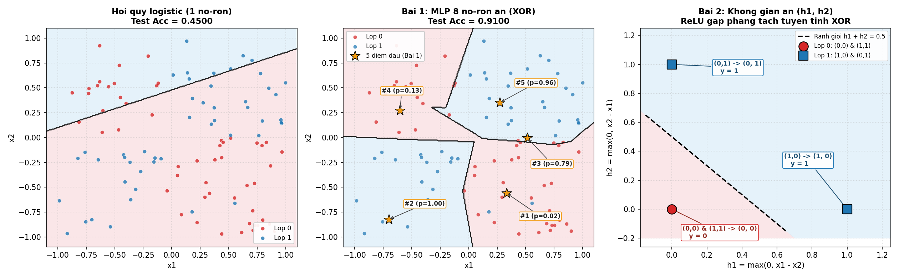
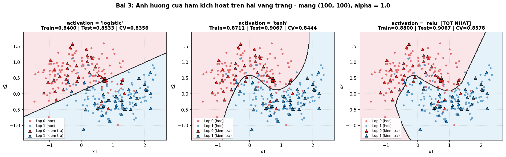
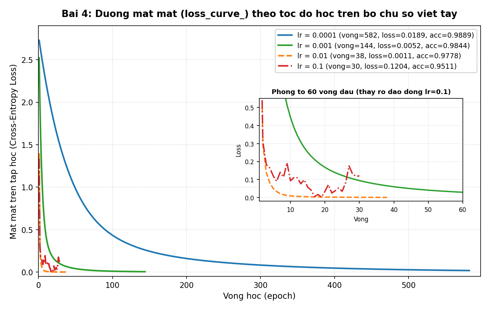
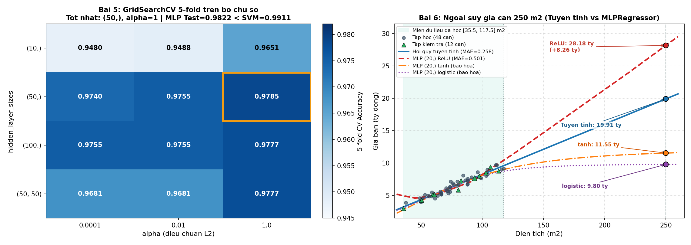

# Báo Cáo & Lời Giải Bài Tập Thực Hành 9: Mạng Nơ-ron Nhiều Lớp (MLP)

Tài liệu: `Lab09_MLP.pdf`  
Môn học: **Học máy ứng dụng** - Khoa Công nghệ Thông tin, Trường Đại học Văn Lang  
Giảng viên: **ThS. Nguyễn Thái Anh**  
Năm học: 2026 – 2027

---

## 📁 Cấu trúc thư mục

```text
09. MLP/
├── data/
│   ├── xor.csv                                     # 400 điểm bài toán XOR 2 chiều (phi tuyến)
│   ├── hai_vang_trang.csv                          # 300 điểm hai vầng trăng có biên cong
│   ├── sinh_vien_mo_rong.csv                       # 120 sinh viên (thang đo chi_tieu hàng nghìn)
│   └── gia_nha.csv                                 # 60 căn hộ bài 1 (diện tích, số phòng, tuổi nhà, giá)
├── baitap09/                                       # 6 bài tập tự luyện được yêu cầu nộp
│   ├── bai1.py                                     # Tự tính lan truyền tiến bằng numpy từ coefs_/intercepts_
│   ├── bai2.py                                     # Kiểm chứng & giải thích mạng XOR: max(0,x1-x2)+max(0,x2-x1)
│   ├── bai3.py                                     # So sánh hàm kích hoạt logistic, tanh, relu trên hai vầng trăng
│   ├── bai4.py                                     # Khảo sát tốc độ học learning_rate_init & vẽ toc_do_hoc.png
│   ├── bai5.py                                     # Dò lưới GridSearchCV (hidden_layer_sizes × alpha) trên chữ số
│   ├── bai6.py                                     # MLPRegressor vs hồi quy tuyến tính & ngoại suy căn 250 m²
│   ├── toc_do_hoc.png                              # Biểu đồ 4 đường loss_curve_ của Bài 4 (kèm phóng to 60 vòng đầu)
│   ├── screenshot_bai1.png -> screenshot_bai6.png  # Ảnh chụp màn hình kết quả chạy terminal PowerShell
│   ├── hinh_anh_xor_bai1_bai2.png                  # Ranh giới XOR (Bài 1) & không gian ẩn (h1, h2) (Bài 2)
│   ├── hinh_anh_kich_hoat_hai_vang_trang.png       # Biên quyết định logistic vs tanh vs relu (Bài 3)
│   ├── hinh_anh_luoi_va_ngoai_suy.png              # Heatmap GridSearchCV (Bài 5) & ngoại suy giá nhà (Bài 6)
│   └── README.md                                   # Báo cáo tổng hợp chi tiết
├── tao_anh_chup.py                                 # Script tự động chụp màn hình terminal PowerShell
└── ve_bieu_do.py                                   # Script vẽ các biểu đồ trực quan phân tích
```

### Cách thực thi các bài tập

Từ thư mục `09. MLP`:
```bash
# Chạy từng bài tập trong thư mục baitap09 theo đúng yêu cầu đề bài
python baitap09/bai1.py
python baitap09/bai2.py
python baitap09/bai3.py
python baitap09/bai4.py
python baitap09/bai5.py
python baitap09/bai6.py
```
*(Các script sử dụng đường dẫn `data/...` đúng như yêu cầu đề bài, đồng thời có cơ chế dự phòng tự tìm tệp dữ liệu nếu chạy từ thư mục khác).*

---

## 📌 Tổng quan các con số kết quả chính

Bảng đối chiếu kết quả thực nghiệm với Phụ lục A (Bảng 4) của tài liệu thực hành và tổng hợp 6 bài tập:

| Đại lượng | Giá trị thực nghiệm | Ý nghĩa / Ghi chú |
|---|---|---|
| XOR, hồi quy logistic (mục 3) | **`0.4500`** | Một đường thẳng không thể tách 4 góc XOR (kém hơn tung đồng xu) |
| XOR, MLP 4 và 8 nơ-ron ẩn (mục 3 / Bài 1) | **`0.9300`** và **`0.9100`** | Mạng 8 nơ-ron có **33** tham số; tự tính numpy khớp `predict_proba` (sai lệch $\le 2.78 \times 10^{-17}$) |
| Hai vầng trăng, mạng to `(100, 100)` không điều chuẩn (mục 4) | Train **`1.0000`**, Test **`0.7333`** | Học vẹt nặng (`alpha = 1e-5`), ranh giới uốn lượn quanh từng điểm |
| Hai vầng trăng, mạng `(100, 100)` với `alpha = 1.0` (mục 4 / Bài 3) | Train **`0.8800`**, Test **`0.9067`** | `relu` & `tanh` cùng đạt Test **0.9067** (`relu` thắng CV **0.8578**), vượt xa `logistic` (**0.8533**) |
| Sinh viên mở rộng, không và có chuẩn hoá (mục 5) | **`0.4000`** và **`0.9000`** | Quên chuẩn hoá khiến mạng đoán **0/30** bạn qua; chuẩn hoá tăng vọt lên **0.9000** |
| Chữ số viết tay (`load_digits`), MLP `(100,)` (mục 6) | **7,510** tham số, **144** vòng | Mất mát cuối **0.0052**, Test Accuracy = **`0.9844`** (sai **7 / 450** ảnh) |
| Tốc độ học `learning_rate_init` (Bài 4) | `0.0001 → 0.1`: **582 → 30** vòng | `lr = 0.0001` học rất chậm (Acc **0.9889**); `lr = 0.1` dao động mạnh (loss **0.1204**, Acc **0.9511**) |
| Dò lưới `GridSearchCV` trên chữ số (Bài 5) | Tốt nhất `(50,), alpha = 1` | CV = **`0.9785`**, Test = **`0.9822`** (sai 8/450) — **không vượt được SVM RBF** (**`0.9911`**, sai 4/450) |
| Hồi quy giá nhà & ngoại suy căn 250 m² (Bài 6) | Tuyến tính: MAE **`0.2578`**, **`19.91`** tỷ | `MLPRegressor(20,)`: MAE **`0.5008`**, **`28.18`** tỷ (+41.5%) — **ngoại suy kém hơn rõ rệt** |

---

## 📝 Lời giải & Phân tích chi tiết từng bài tập

---

### Bài tập 1: Tự dự đoán bằng trọng số đã học

#### 1. Yêu cầu đề bài
- Học lại mạng 8 nơ-ron ẩn trên bộ `data/xor.csv` đúng như mục 3 (`solver="lbfgs"`, `max_iter=5000`, `random_state=0`, chia `test_size=0.25`, `random_state=17`, `stratify=y`).
- Lấy `mlp.coefs_` và `mlp.intercepts_`, rồi tự tính lan truyền tiến bằng `numpy` cho 5 điểm đầu của tập kiểm tra: lớp ẩn dùng ReLU, lớp ra dùng sigmoid.
- So kết quả với `mlp.predict_proba`, cột thứ hai. Hai kết quả phải khớp tới nhiều chữ số thập phân.

#### 2. Cấu trúc trọng số & Kết quả đối chiếu
Mạng đã học có 4 mảng tham số với tổng cộng $2 \times 8 + 8 + 8 \times 1 + 1 = \mathbf{33}$ tham số (`Train Acc = 0.9167`, `Test Acc = 0.9100`):
- $W_1 \in \mathbb{R}^{2 \times 8}$, $b_1 \in \mathbb{R}^{8}$ (lớp ẩn 8 nơ-ron ReLU)
- $W_2 \in \mathbb{R}^{8 \times 1}$, $b_2 \in \mathbb{R}^{1}$ (lớp ra 1 nơ-ron sigmoid)

Công thức lan truyền tiến tự tính bằng `numpy`:
$$Z_1 = X_5 W_1 + b_1, \quad H = \max(0, Z_1), \quad Z_2 = H W_2 + b_2, \quad \hat{p} = \sigma(Z_2) = \frac{1}{1 + e^{-Z_2}}$$

| Điểm | $x_1$ | $x_2$ | Nhãn thật | Tự tính (`numpy`) | `mlp.predict_proba[:, 1]` | Sai lệch tuyệt đối |
|---|---|---|---|---|---|---|
| **#1** | `+0.3319` | `-0.5595` | `0` | `0.017557985373` | `0.017557985373` | `0.00e+00` |
| **#2** | `-0.7016` | `-0.8251` | `1` | `0.999434831959` | `0.999434831959` | `0.00e+00` |
| **#3** | `+0.5155` | `-0.0052` | `0` | `0.794331056599` | `0.794331056599` | `0.00e+00` |
| **#4** | `-0.6036` | `+0.2726` | `0` | `0.134400889648` | `0.134400889648` | `2.78e-17` |
| **#5** | `+0.2748` | `+0.3515` | `1` | `0.957805718116` | `0.957805718116` | `0.00e+00` |

- **Sai lệch tuyệt đối lớn nhất**: **`2.78e-17`** (`np.allclose(..., atol=1e-12) == True`) — khớp hoàn toàn tới ~16 chữ số thập phân (giới hạn chính xác của kiểu số thực `float64`).
- **Minh hoạ chi tiết điểm #1** ($x = [+0.3319, -0.5595]$, nhãn thật `0`):
  - $Z_1 = x W_1 + b_1 = [-1.2242,\ 2.3541,\ 0.0294,\ 2.8504,\ 2.1716,\ -0.8529,\ 3.9835,\ -2.9360]$
  - $H = \text{ReLU}(Z_1) = [0,\ 2.3541,\ 0.0294,\ 2.8504,\ 2.1716,\ 0,\ 3.9835,\ 0]$ (**5/8** nơ-ron ẩn bật, **3/8** bị tắt về 0)
  - $z_2 = H W_2 + b_2 = -4.024532 \implies \sigma(-4.024532) = \mathbf{0.017557985373}$ (rất tự tin là lớp 0).

#### 3. Giải thích bản chất phép tính bên trong mạng nơ-ron
1. **Không phải "hộp đen"**: Việc tự tính bằng 4 phép toán đại số cơ bản khớp chính xác 16 chữ số thập phân với `predict_proba[:, 1]` chứng minh mọi suy luận của `MLPClassifier` đều là chuỗi nhân ma trận, cộng hệ số chặn và áp hàm kích hoạt.
2. **Vai trò từng bước**:
   - Lớp ẩn tính 8 tổ hợp tuyến tính $Z_1 = X W_1 + b_1$ (mỗi nơ-ron tương ứng một đường thẳng cắt mặt phẳng $(x_1, x_2)$).
   - Hàm **ReLU** giữ nguyên nửa mặt phẳng dương và tắt nửa âm về 0, bẻ gãy tính tuyến tính để 8 nơ-ron ghép thành ranh giới phi tuyến chia 4 góc phần tư của XOR.
   - Lớp ra tổng hợp 8 đặc trưng ẩn thành điểm logit $z_2 = H W_2 + b_2$, rồi hàm **sigmoid** nén $z_2 \in (-\infty, +\infty)$ về xác suất $P(y=1 \mid x) \in (0, 1)$ — chính là cột thứ hai của `predict_proba`.
3. **Lưu ý ở điểm #3** (`(+0.5155, -0.0052)`): Tọa độ $x_2 = -0.0052$ nằm cực sát trục $x_2 = 0$ (ranh giới chuyển giữa góc phần tư I và IV), nên mạng gán xác suất $p = 0.7943 > 0.5$ và đoán nhầm sang lớp 1 dù nhãn thật là 0.

---

### Bài tập 2: Một mạng XOR khác

#### 1. Yêu cầu đề bài
- Kiểm chứng bằng `numpy` rằng mạng sau cũng tính đúng XOR:
  $$h_1 = \max(0, x_1 - x_2), \quad h_2 = \max(0, x_2 - x_1), \quad y = h_1 + h_2$$
- Giải thích bằng lời vì sao mạng này đúng.

#### 2. Kiểm chứng bằng `numpy`
Biểu diễn dưới dạng ma trận trọng số với **hệ số chặn bằng 0** ($b_1 = [0, 0]$, $b_2 = 0$):
$$W_1 = \begin{bmatrix} 1 & -1 \\ -1 & 1 \end{bmatrix}, \qquad W_2 = \begin{bmatrix} 1 \\ 1 \end{bmatrix}$$

| $x_1$ | $x_2$ | $x_1 - x_2$ | $x_2 - x_1$ | $h_1 = \max(0, x_1 - x_2)$ | $h_2 = \max(0, x_2 - x_1)$ | $y = h_1 + h_2$ | XOR chuẩn | Khớp? |
|---|---|---|---|---|---|---|---|---|
| `0` | `0` | `0` | `0` | `0` | `0` | **`0`** | `0` | ĐÚNG |
| `0` | `1` | `-1` | `+1` | `0` | `1` | **`1`** | `1` | ĐÚNG |
| `1` | `0` | `+1` | `-1` | `1` | `0` | **`1`** | `1` | ĐÚNG |
| `1` | `1` | `0` | `0` | `0` | `0` | **`0`** | `0` | ĐÚNG |

Tính cả bảng một lần bằng nhân ma trận `Y = relu(X @ W1 + b1) @ W2 + b2` thu được `[0. 1. 1. 0.]`, khớp tuyệt đối (`np.array_equal == True`) với bảng chân trị XOR.

#### 3. Giải thích bằng lời vì sao mạng này đúng
1. **Vai trò chuyên biệt của từng nơ-ron ẩn**:
   - Nơ-ron $h_1 = \max(0, x_1 - x_2)$ chỉ bật (`= 1`) khi $x_1 > x_2$, tức là nhận diện duy nhất cặp $(1, 0)$; ở 3 cặp còn lại $x_1 - x_2 \le 0$ nên ReLU ép $h_1 = 0$.
   - Nơ-ron $h_2 = \max(0, x_2 - x_1)$ chỉ bật (`= 1`) khi $x_2 > x_1$, tức là nhận diện duy nhất cặp $(0, 1)$; ở 3 cặp còn lại $x_2 - x_1 \le 0$ nên ReLU ép $h_2 = 0$.
   - Khi hai đầu vào **giống nhau** — $(0, 0)$ hoặc $(1, 1)$ — cả $x_1 - x_2$ và $x_2 - x_1$ đều bằng $0$, nên cả hai nơ-ron đều tắt $\implies y = 0 + 0 = 0$.
   - Khi hai đầu vào **khác nhau** — $(0, 1)$ hoặc $(1, 0)$ — có đúng một nơ-ron bật lên bằng $1$ và nơ-ron kia bằng $0 \implies y = h_1 + h_2 = 1$.
2. **Bản chất đại số**: Với mọi số thực $a$, ta luôn có đồng nhất thức $\max(0, a) + \max(0, -a) = |a|$. Thay $a = x_1 - x_2$, đầu ra của mạng chính là:
   $$y = h_1 + h_2 = \max(0, x_1 - x_2) + \max(0, -(x_1 - x_2)) = |x_1 - x_2|$$
   Trên tập nhị phân $\{0, 1\}$, $|x_1 - x_2|$ bằng $0$ khi $x_1 = x_2$ và bằng $1$ khi $x_1 \neq x_2$ — đúng định nghĩa toán học của phép XOR.
3. **Góc nhìn hình học & so sánh với mục 2**:
   - Trong không gian ẩn $(h_1, h_2)$, hàm ReLU đã "gấp" mặt phẳng dọc theo đường chéo $x_1 = x_2$: hai điểm lớp 0 là $(0, 0)$ và $(1, 1)$ cùng rơi về gốc tọa độ $(0, 0)$, còn hai điểm lớp 1 nằm tại $(1, 0)$ và $(0, 1)$. Khi đó chỉ cần một đường thẳng $h_1 + h_2 = 0.5$ là tách gọn hai lớp.
   - So với mạng ở mục 2 ($h_1 = \max(0, x_1 + x_2),\ h_2 = \max(0, x_1 + x_2 - 1),\ y = h_1 - 2h_2$) cần hệ số chặn $b_1 = [0, -1]$ và trọng số âm $-2$, mạng ở Bài 2 **không cần hệ số chặn nào** ($b_1 = [0, 0], b_2 = 0$). Điều này minh chứng một bài toán trong mạng nơ-ron có thể có **nhiều bộ trọng số khác nhau** cùng cho lời giải chính xác.



---

### Bài tập 3: So các hàm kích hoạt

#### 1. Yêu cầu đề bài
- Trên bộ `data/hai_vang_trang.csv`, dùng mạng hai lớp ẩn 100 nơ-ron với `alpha = 1.0` như mục 4 (`StandardScaler`, `solver="lbfgs"`, `max_iter=20000`, `random_state=0`).
- Lần lượt đặt `activation` bằng `"logistic"`, `"tanh"` và `"relu"`.
- Ghi lại accuracy trên tập học và tập kiểm tra, và kết luận hàm nào cho kết quả tốt nhất.

#### 2. Bảng kết quả thực nghiệm

| Hàm kích hoạt (`activation`) | Accuracy tập học | Accuracy tập kiểm tra | 5-fold CV (tập học) | Số vòng học (`n_iter_`) |
|---|---|---|---|---|
| `"logistic"` (Sigmoid) | `0.8400` | `0.8533` | `0.8356` | `64` |
| `"tanh"` | `0.8711` | **`0.9067`** | `0.8444` | `318` |
| **`"relu"`** ⭐ | **`0.8800`** | **`0.9067`** | **`0.8578`** | `992` |

#### 3. Trả lời & Phân tích
- **Hàm nào cho kết quả tốt nhất ở đây?**: **`"relu"`** là hàm tốt nhất tổng thể. Cả `"relu"` và `"tanh"` cùng đạt Accuracy tập kiểm tra cao nhất là **`0.9067`** (đoán đúng 68/75 mẫu, hơn `"logistic"` `+0.0533`), nhưng `"relu"` vượt trội hơn `"tanh"` cả trên tập học (`0.8800` vs `0.8711`) lẫn kiểm định chéo 5 phần (`0.8578` vs `0.8444`).
- **Vì sao `"logistic"` kém rõ rệt (`0.8533`)?**:
  - Đạo hàm cực đại của hàm sigmoid chỉ đạt $0.25$ tại $z = 0$ và đầu ra nằm hoàn toàn trong $(0, 1)$ (không đối xứng quanh 0).
  - Khi đi qua 2 lớp ẩn `(100, 100)` kèm điều chuẩn L2 mạnh (`alpha = 1.0`) ép trọng số nhỏ, tín hiệu độ dốc suy giảm nhanh (*vanishing gradient*), khiến mạng dừng sớm ở vòng 64 với biên quyết định gần như một đường thẳng cẩu thả (*underfitting*).
- **Vì sao `"tanh"` và `"relu"` tốt?**:
  - `"tanh"` đối xứng quanh 0 với độ dốc cực đại bằng $1.0$ (gấp 4 lần sigmoid), còn `"relu"` giữ đạo hàm hằng số bằng $1$ trên toàn miền dương $z > 0$ (không bị bão hòa ở phía dương), nên cả hai uốn mượt ranh giới theo đúng hình hai vầng trăng. Đây cũng là lý do `scikit-learn` chọn `"relu"` làm mặc định.



---

### Bài tập 4: Tốc độ học

#### 1. Yêu cầu đề bài
- Trên bộ chữ số viết tay (`load_digits`), dùng mạng một lớp ẩn 100 nơ-ron (`StandardScaler`, `solver="adam"`, `max_iter=1000`, `random_state=0`), lần lượt đặt `learning_rate_init` bằng `0.0001`, `0.001`, `0.01` và `0.1`.
- Với mỗi giá trị, ghi số vòng học `n_iter_`, mất mát cuối cùng và accuracy trên tập kiểm tra.
- Vẽ bốn đường `loss_curve_` lên cùng một hình và lưu thành `toc_do_hoc.png`.
- Giải thích tốc độ học quá lớn và quá nhỏ gây ra chuyện gì.

#### 2. Bảng kết quả thực nghiệm

| `learning_rate_init` | Số vòng (`n_iter_`) | Mất mát vòng cuối | Mất mát nhỏ nhất | Accuracy tập kiểm tra | Nhận xét hội tụ |
|---|---|---|---|---|---|
| **`0.0001`** (quá nhỏ) | `582` | `0.018928` | `0.018928` | **`0.9889`** (sai 5/450) | Giảm cực kỳ chậm, tốn ~4× số vòng của `0.001` |
| **`0.001`** (mặc định) | `144` | `0.005210` | `0.005210` | `0.9844` (sai 7/450) | Hội tụ mượt mà, cân bằng tốt tốc độ & độ chính xác |
| **`0.01`** (khá lớn) | `38` | **`0.001077`** | `0.001077` | `0.9778` (sai 10/450) | Hội tụ rất nhanh, mất mát thấp nhưng tổng quát hóa giảm nhẹ |
| **`0.1`** (quá lớn) | `30` | `0.120373` | `0.002745` (vòng 19) | **`0.9511`** (sai 22/450) | Nhảy vọt qua đáy, dao động dữ dội, kết quả tệ nhất |



#### 3. Giải thích tác hại của tốc độ học quá nhỏ và quá lớn
1. **Tốc độ học quá nhỏ (`lr = 0.0001`)**:
   - Mỗi bước cập nhật trọng số quá bé nên hàm mất mát hạ xuống rất chậm: mạng phải chạy tới **582 vòng** (gấp ~4 lần `lr = 0.001` và ~15 lần `lr = 0.01`), nhưng mất mát cuối vẫn còn `0.0189`.
   - Làm tốn nhiều thời gian huấn luyện; nếu giữ `max_iter = 200` mặc định thì mạng sẽ bị ngắt giữa chừng khi chưa hội tụ (phát sinh `ConvergenceWarning`). Tuy nhiên, khi được cấp đủ vòng (`max_iter = 1000`), bước đi thận trọng lại giúp mạng tránh học vẹt nhẹ và đạt Test Accuracy rất cao (`0.9889`).
2. **Tốc độ học quá lớn (`lr = 0.1`)**:
   - Bước nhảy cập nhật trọng số quá mạnh làm thuật toán **nhảy vọt qua đáy cực tiểu và dao động thất thường**: trên biểu đồ phóng to 60 vòng đầu, đường màu đỏ từng chạm mất mát cực tiểu `0.0027` ở vòng 19 nhưng ngay lập tức bật ngược lên `0.0715`, `0.1757` rồi dừng ở vòng 30 với mất mát cuối **`0.1204`** (cao gấp 44 lần đáy của chính nó!) do 10 vòng liên tiếp không cải thiện được kỷ lục vòng 19.
   - Hậu quả: mạng không thể ổn định quanh nghiệm tốt, khiến Accuracy trên tập kiểm tra tụt mạnh xuống còn **`0.9511`** (sai 22/450 ảnh — gấp hơn 3 lần số lỗi của `lr = 0.001`).

---

### Bài tập 5: Dò lưới cho mạng nơ-ron

#### 1. Yêu cầu đề bài
- Dùng `GridSearchCV` (5-fold CV) trên bộ chữ số với `hidden_layer_sizes` trong `(10,)`, `(50,)`, `(100,)`, `(50, 50)` và `alpha` trong `0.0001`, `0.01`, `1`.
- Mô hình là `make_pipeline(StandardScaler(), MLPClassifier(max_iter=1000, random_state=0))`, tên tham số trong lưới viết dạng `"mlpclassifier__hidden_layer_sizes"` và `"mlpclassifier__alpha"`.
- Cho biết cặp nào tốt nhất và Accuracy trên tập kiểm tra có vượt được SVM không.

#### 2. Ma trận điểm kiểm định chéo 5 phần (12 cặp tham số)

| `hidden_layer_sizes` \ `alpha` | `0.0001` | `0.01` | `1` | Số tham số mạng |
|---|---|---|---|---|
| **`(10,)`** | `0.9480` | `0.9488` | `0.9651` | `760` |
| **`(50,)`** | `0.9740` | `0.9755` | **`0.9785`** ⭐ | `3,760` |
| **`(100,)`** | `0.9755` | `0.9755` | `0.9777` | `7,510` |
| **`(50, 50)`** | `0.9681` | `0.9681` | `0.9777` | `6,310` |

| Mô hình trên cùng tập kiểm tra (450 ảnh) | Điểm 5-fold CV | Accuracy tập kiểm tra | Số ảnh đoán sai |
|---|---|---|---|
| **MLP tốt nhất (`GridSearchCV`: `(50,), alpha = 1`)** | **`0.9785`** | **`0.9822`** | `8 / 450` |
| MLP mặc định mục 6 (`(100,), alpha = 0.0001`) | `0.9755` | `0.9844` | `7 / 450` |
| **SVM kernel RBF (`SVC()`, đối chiếu)** | — | **`0.9911`** | **`4 / 450`** |

#### 3. Trả lời & Phân tích
1. **Cặp nào tốt nhất?**: **`hidden_layer_sizes = (50,)` và `alpha = 1`**, đạt điểm 5-fold CV cao nhất **`0.9785`** (sát nút là `(100,), alpha = 1` và `(50, 50), alpha = 1` cùng đạt `0.9777`).
2. **Accuracy trên tập kiểm tra có vượt được SVM không?**: **KHÔNG vượt được SVM**. MLP tối ưu từ dò lưới đạt **`0.9822`** (sai 8/450 ảnh), thấp hơn SVM kernel RBF (**`0.9911`**, chỉ sai 4/450 ảnh) đúng `-0.0089`.
3. **Nhận xét chuyên sâu**:
   - Ở cả 4 kiến trúc mạng, tăng độ nặng điều chuẩn lên `alpha = 1` đều cải thiện rõ rệt điểm CV — chứng tỏ tập dữ liệu 1,347 ảnh với 64 đặc trưng dễ học vẹt nhẹ khi dùng `alpha = 0.0001`.
   - Kiến trúc 1 lớp ẩn 50 nơ-ron (`3,760` tham số) đủ năng lực biểu diễn và ít học vẹt hơn mạng 2 lớp `(50, 50)` (`6,310` tham số), trong khi `(10,)` (`760` tham số) quá hẹp nên điểm thấp nhất.
   - Đúng như lưu ý của bài thực hành (*"Mạng nơ-ron không phải lúc nào cũng thắng"*): trên bộ ảnh nhỏ $8 \times 8$ gồm 1,797 mẫu, SVM kernel RBF tìm được siêu phẳng lề cực đại tối ưu toàn cục và giữ nguyên thang đo đồng nhất `0..16` (không bị `StandardScaler` khuếch đại nhiễu ở các pixel viền ít phương sai), nên vẫn vượt trội hơn MLP.

---

### Bài tập 6: Mạng nơ-ron cho hồi quy

#### 1. Yêu cầu đề bài
- Trên dữ liệu `data/gia_nha.csv` của Bài 1 (`X = df[["dien_tich"]]`, `y = df["gia"]`, chia `test_size=0.2`, `random_state=42`), dùng `MLPRegressor(hidden_layer_sizes=(20,), max_iter=5000, random_state=0)` có chuẩn hoá (`StandardScaler`).
- So sánh `MAE` trên tập kiểm tra với hồi quy tuyến tính (`LinearRegression`).
- Dự đoán giá căn **250 m²** và nhận xét: mạng nơ-ron có ngoại suy tốt như đường thẳng không?

#### 2. Kết quả thực nghiệm & Ngoại suy

Dữ liệu 60 căn hộ có diện tích nằm hoàn toàn trong khoảng **$[35.5,\ 117.5]\text{ m}^2$** (48 căn tập học, 12 căn tập kiểm tra). Đường thẳng hồi quy tuyến tính học được: $\widehat{\text{gia}} = 0.077837 \times \text{dien\_tich} + 0.454717$.

| Mô hình | Số tham số | MAE tập kiểm tra (tỷ) | $R^2$ tập kiểm tra | Dự đoán căn 250 m² | Chênh lệch so với đường thẳng |
|---|---|---|---|---|---|
| **Hồi quy tuyến tính (đường thẳng)** | `2` | **`0.2578`** | **`0.9622`** | **`19.9139` tỷ** | `0.00` tỷ (chuẩn tuyến tính) |
| **`MLPRegressor(20,)`, ReLU [đề bài]** | `61` | **`0.5008`** | **`0.8557`** | **`28.1758` tỷ** | **`+8.26` tỷ (+41.5%)** |
| *Tham khảo: `MLPRegressor(20,)`, `tanh`* | `61` | `0.2592` | `0.9543` | `11.5483` tỷ | `-8.37` tỷ (bão hòa phẳng) |
| *Tham khảo: `MLPRegressor(20,)`, `logistic`* | `61` | `0.2747` | `0.9471` | `9.7952` tỷ | `-10.12` tỷ (bão hòa phẳng) |

| Diện tích (m²) | Hồi quy tuyến tính (tỷ) | `MLPRegressor(20,)` ReLU (tỷ) | Chênh lệch | Vị trí so với miền học `[35.5, 117.5]` |
|---|---|---|---|---|
| `35.0` | `3.1790` | `4.9621` | `+1.7830` | Ngoại suy (mép trái) |
| `60.0` | `5.1249` | `5.0517` | `-0.0733` | Trong miền học |
| `80.0` | `6.6817` | `6.3589` | `-0.3228` | Trong miền học |
| `100.0` | `8.2384` | `8.2354` | `-0.0030` | Trong miền học |
| `117.5` | `9.6006` | `10.4318` | `+0.8313` | Mép phải miền học |
| `150.0` | `12.1303` | `14.6890` | `+2.5588` | Ngoại suy |
| `200.0` | `16.0221` | `21.3555` | `+5.3334` | Ngoại suy |
| **`250.0`** | **`19.9139`** | **`28.1758`** | **`+8.2619`** | **Ngoại suy xa** |



#### 3. Trả lời & Phân tích
- **Mạng nơ-ron có ngoại suy tốt như đường thẳng không?**: **KHÔNG — mạng nơ-ron ngoại suy kém hơn rõ rệt so với đường thẳng tuyến tính.**
- **Giải thích cụ thể**:
  1. **Ngay trong miền nội suy (tập kiểm tra)**: `MAE` của `MLPRegressor(20,)` (`0.5008` tỷ) cao **gần gấp đôi** hồi quy tuyến tính (`0.2578` tỷ), và $R^2$ giảm từ `0.9622` xuống `0.8557`. Nguyên nhân là tập học chỉ có 48 căn nhưng mạng 20 nơ-ron ẩn có tới **61 tham số** ($1 \times 20 + 20 + 20 \times 1 + 1$) — nhiều hơn cả số mẫu học, nên hàm gấp khúc ReLU bị uốn cong lệch ở hai đầu miền dữ liệu (thậm chí tại `35 m²` lại vồng ngược lên `4.96` tỷ!).
  2. **Khi ngoại suy căn 250 m²** (gấp hơn 2 lần căn lớn nhất `117.5 m²` trong dữ liệu):
     - Đường thẳng tuyến tính duy trì đúng độ dốc toàn cục $\approx 0.0778\text{ tỷ/m}^2$ và dự đoán **`19.91` tỷ đồng**.
     - `MLPRegressor` dùng ReLU kéo dài mù quáng độ dốc cục bộ quá gắt ở rìa phải ($\approx 0.136\text{ tỷ/m}^2$, gấp ~1.75 lần độ dốc thật) nên dự đoán vọt lên **`28.18` tỷ đồng** — lệch dương tới **`+8.26` tỷ (+41.5%)**.
  3. **Trường hợp dùng hàm kích hoạt bị chặn (`tanh` / `logistic`)**: Khả năng ngoại suy còn lộ nhược điểm rõ hơn nữa — vì hàm kích hoạt tiến về tiệm cận ngang khi $|z|$ lớn, đường dự đoán bị bão hòa phẳng hoàn toàn và chỉ đoán `11.55` tỷ (`tanh`) hoặc `9.80` tỷ (`logistic`) cho căn 250 m², dù căn 115 m² đã có giá gần 9–10 tỷ!
  4. **Bài học thực tiễn**: Mạng nơ-ron mạnh về **nội suy** trên các quan hệ phi tuyến phức tạp khi có nhiều dữ liệu, nhưng **không đáng tin khi ngoại suy** ra ngoài miền đã học; với dữ liệu nhỏ có quy luật tuyến tính rõ ràng, mô hình hồi quy tuyến tính đơn giản vẫn vừa chính xác hơn vừa ổn định hơn.

---

## 🖼️ Ảnh chụp màn hình kết quả chạy thực tế

Toàn bộ 6 ảnh chụp màn hình terminal PowerShell đã được tự động tạo và lưu trong thư mục `baitap09/`:

| Bài tập | Tệp ảnh kết quả | Nội dung kiểm chứng |
|---|---|---|
| **Bài 1** | `baitap09/screenshot_bai1.png` | Tự tính lan truyền tiến numpy 5 điểm XOR, khớp `predict_proba[:, 1]` (sai lệch $\le 2.78\times 10^{-17}$) + giải thích |
| **Bài 2** | `baitap09/screenshot_bai2.png` | Kiểm chứng numpy mạng $h_1=\max(0,x_1-x_2), h_2=\max(0,x_2-x_1), y=h_1+h_2$ + giải thích đầy đủ |
| **Bài 3** | `baitap09/screenshot_bai3.png` | So sánh `logistic` (0.8533), `tanh` (0.9067), `relu` (0.9067, CV 0.8578) trên hai vầng trăng |
| **Bài 4** | `baitap09/screenshot_bai4.png` | Khảo sát `learning_rate_init` (`0.0001`..`0.1`), lưu `toc_do_hoc.png` + phân tích quá nhỏ / quá lớn |
| **Bài 5** | `baitap09/screenshot_bai5.png` | Bảng `GridSearchCV` 12 cặp (`(50,), alpha=1`, CV 0.9785, Test 0.9822) vs SVM RBF (0.9911) |
| **Bài 6** | `baitap09/screenshot_bai6.png` | So sánh MAE `MLPRegressor` (0.5008) vs tuyến tính (0.2578) và ngoại suy căn 250 m² (28.18 vs 19.91 tỷ) |

---

## 💡 Phụ lục: Các lỗi thường gặp và cách xử lý khi dùng MLP

Trích từ Phụ lục B (Bảng 5) tài liệu thực hành `Lab09_MLP.pdf`:

1. **`ConvergenceWarning: Stochastic Optimizer: Maximum iterations reached`**:
   - *Nguyên nhân*: Mạng chưa hội tụ hết sau số vòng tối đa cho phép (thường gặp khi tốc độ học quá nhỏ hoặc dữ liệu chưa chuẩn hoá).
   - *Cách xử lý*: Tăng `max_iter` (ví dụ `1000`–`5000`), kiểm tra lại xem đã chuẩn hoá dữ liệu bằng `StandardScaler` chưa, hoặc thử `solver="lbfgs"` cho tập dữ liệu nhỏ.
2. **Mạng đoán mọi mẫu vào cùng một lớp** (ví dụ `0/30` bạn được đoán qua ở mục 5):
   - *Nguyên nhân*: Quên chuẩn hoá khi các cột lệch thang đo hàng trăm/hàng nghìn lần khiến $z$ quá lớn và độ dốc bị một cột chi phối.
   - *Cách xử lý*: Luôn bọc trong `make_pipeline(StandardScaler(), MLPClassifier(...))`.
3. **Mỗi lần chạy ra một kết quả khác nhau**:
   - *Nguyên nhân*: Trọng số ban đầu của mạng nơ-ron được khởi tạo ngẫu nhiên.
   - *Cách xử lý*: Cố định tham số `random_state` (ví dụ `random_state=0`).
4. **Accuracy tập học gần `1.0`, tập kiểm tra thấp**:
   - *Nguyên nhân*: Mạng quá lớn so với lượng dữ liệu nên bị học vẹt (*overfitting*).
   - *Cách xử lý*: Tăng hệ số điều chuẩn L2 `alpha`, giảm số nơ-ron/số lớp ẩn, hoặc bật `early_stopping=True` (khi có dấu hiệu học vẹt và đủ dữ liệu).
5. **`AttributeError: 'MLPClassifier' object has no attribute 'loss_curve_'`**:
   - *Nguyên nhân*: Đang sử dụng `solver="lbfgs"`. Thuộc tính `loss_curve_` chỉ tồn tại với bộ giải tối ưu lặp theo lô `"adam"` và `"sgd"`.
   - *Cách xử lý*: Đổi sang `solver="adam"` (hoặc `"sgd"`) khi cần vẽ đường mất mát.
6. **Mạng học rất chậm**:
   - *Nguyên nhân*: Kiến trúc mạng quá nhiều lớp/nơ-ron, hoặc `learning_rate_init` đặt quá nhỏ (như `0.0001` mất 582 vòng ở Bài 4).
   - *Cách xử lý*: Bắt đầu với cấu hình đơn giản một lớp ẩn vừa phải (ví dụ `(100,)` có chuẩn hoá, tham số mặc định) và luôn so sánh với hồi quy logistic, rừng ngẫu nhiên hoặc SVM trước khi kết luận mạng nơ-ron là tốt nhất.
